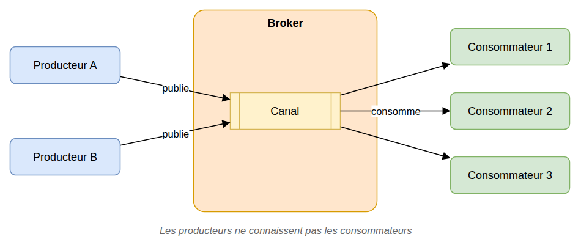
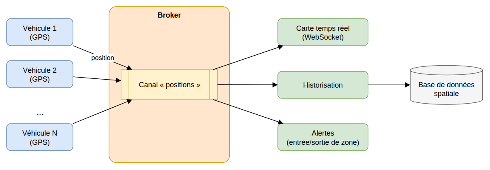
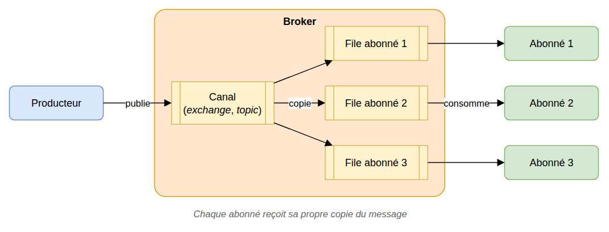
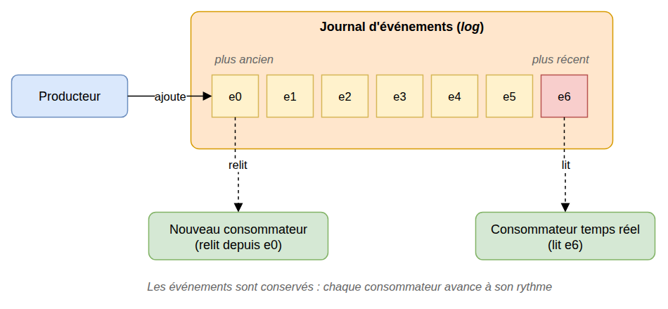

# Architecture pilotée par les événements (EDA)

> 🤖 Rédaction assistée par IA.

## Problème

Nous souhaitons **faire communiquer les composants d'un système sans les coupler fortement** :

* Un composant ne doit pas avoir à **connaître tous les composants intéressés** par ce qu'il produit
* Il ne doit pas avoir à **attendre la fin d'un traitement long** réalisé par un autre composant
* Il doit être possible d'**ajouter de nouveaux traitements sans modifier les composants existants**

Avec des appels directs (ex : appels HTTP d'un service à l'autre), chaque nouveau besoin implique la modification de l'appelant et la panne d'un composant se propage aux autres.

## Cas d'école

Des véhicules équipés de GPS transmettent régulièrement leur position. **Plusieurs traitements indépendants exploitent ces positions** :

* Affichage sur une carte en temps réel
* Historisation dans une base de données spatiale
* Détection de l'entrée ou de la sortie d'une zone
* ...

Si chaque véhicule appelle directement ces traitements, **l'ajout d'un nouveau traitement implique de modifier les véhicules** et l'indisponibilité d'un traitement perturbe l'envoi des positions.

## Solution

Dans une **architecture pilotée par les événements** (*Event-Driven Architecture*, EDA), **les composants communiquent entre eux à l'aide de messages** :

* Les **producteurs** publient des **messages** (ou **événements**) sans savoir qui les traitera
* Un **intermédiaire** (*broker*) reçoit, stocke et achemine ces messages
* Les **consommateurs** traitent les messages qui les concernent, à leur rythme

Ce principe est proche de celui du patron [Observer](../comportement/Observer.md), appliqué à l'**échelle du système** : l'intermédiaire supprime la dépendance directe entre producteurs et consommateurs, qui peuvent être déployés, mis à l'échelle et arrêtés indépendamment.

Dans notre cas d'école, **les véhicules publient leurs positions sur un canal** sans connaître les traitements et **chaque traitement s'abonne à ce canal**. **Ajouter un nouveau traitement revient à ajouter un abonné**, sans modifier ni les véhicules ni les autres traitements :

## Variantes

Il existe **deux styles d'implémentation** des intermédiaires qui se distinguent par le **devenir des messages une fois consommés** :

* Avec la **publication/abonnement**, les messages sont **supprimés** une fois distribués aux abonnés
* Avec le **flux d'événements**, les messages sont **conservés** dans un journal que les consommateurs peuvent relire

### Publication/abonnement (*pub/sub*)

**Les consommateurs s'abonnent à un canal pour recevoir les messages**. Chaque abonné reçoit sa propre copie de chaque message publié. **Une fois consommé, le message disparaît** : un abonné qui arrive plus tard ne recevra que les nouveaux messages.

> Exemples : [RabbitMQ](https://www.rabbitmq.com/tutorials) (*exchanges* et *queues*), [MQTT](https://mqtt.org/), Redis Pub/Sub...

### Flux d'événements (*event streaming*)

**Les événements sont journalisés** dans un journal ordonné (*log*) et **conservés**. Chaque consommateur mémorise sa position dans le journal, et **un consommateur peut relire les anciens messages** (ex : nouveau traitement, reprise après incident, reconstruction d'un état).

> Exemples : [Apache Kafka](https://kafka.apache.org/), [RabbitMQ Streams](https://www.rabbitmq.com/docs/streams)...

## Mises en garde

* **Cohérence à terme** : les traitements étant asynchrones, l'état du système n'est **pas immédiatement à jour** partout
* **Messages en double** : la plupart des intermédiaires garantissent une livraison « au moins une fois ». Les **consommateurs doivent être idempotents** (traiter deux fois le même message ne doit pas poser problème)
* **Ordre des messages** : il n'est pas toujours garanti (en particulier avec plusieurs consommateurs en parallèle)
* **Gestion des erreurs** : il faut prévoir le cas des messages qui ne peuvent être traités (nouvelles tentatives, file des messages en erreur ou *dead letter queue*)
* **Suivi et débogage plus difficiles** : un traitement est réparti entre plusieurs composants. Il est nécessaire de **tracer les messages** (identifiant de corrélation, journaux centralisés)
* **Format des messages** : les messages forment un **contrat entre producteurs et consommateurs** qu'il convient de documenter et de faire évoluer avec précaution
* L'intermédiaire devient un **composant critique** du système : sa disponibilité et sa supervision doivent être assurées
* Il convient de **réserver cette architecture aux cas qui le justifient** : un simple appel direct reste préférable lorsqu'une réponse immédiate est attendue

## Liens utiles

* [learn.microsoft.com - Style d'architecture basée sur les événements](https://learn.microsoft.com/fr-fr/azure/architecture/guide/architecture-styles/event-driven)
* [learn.microsoft.com - Modèle Éditeur-Abonné](https://learn.microsoft.com/fr-fr/azure/architecture/patterns/publisher-subscriber)
* [www.rabbitmq.com - RabbitMQ Tutorials](https://www.rabbitmq.com/tutorials)
* [kafka.apache.org - Introduction](https://kafka.apache.org/intro)
* [martinfowler.com - What do you mean by "Event-Driven"?](https://martinfowler.com/articles/201701-event-driven.html)
* [mborne.github.io/cours-archi-si-geo - Architecture pilotée par les événements (EDA)](https://mborne.github.io/cours-archi-si-geo/#57)
