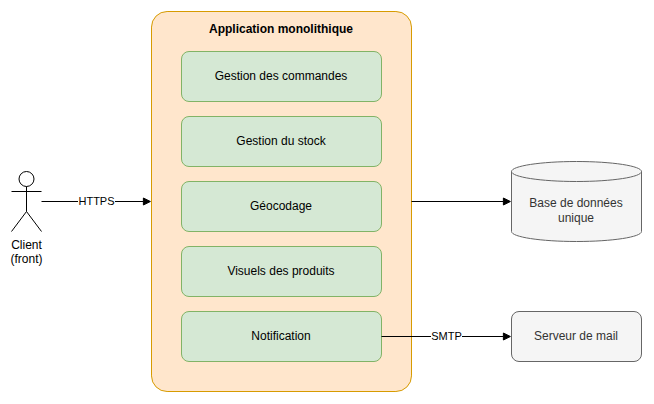
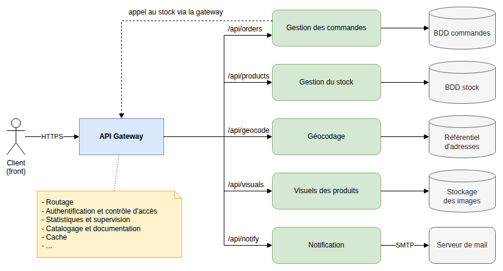

# Architecture microservices

> 🤖 Rédaction assistée par IA.

## Problème

Dans une **architecture monolithique**, une **base de code unique** assure **plusieurs fonctions métier** dont les composants sont **interdépendants**. Lorsque l'application grandit :

* La moindre modification implique de **tester et redéployer l'ensemble de l'application**
* La **mise à l'échelle d'une seule fonctionnalité** (ex : la plus sollicitée) implique de **déployer l'ensemble de l'application**
* Une erreur dans un composant (ex : fuite mémoire) peut **rendre toute l'application indisponible**
* Les équipes se partagent une même base de code et **les choix techniques s'imposent à toutes les fonctionnalités**

## Cas d'école

Une **application de vente en ligne** de produits cartographiques assure plusieurs fonctions :

* La gestion des commandes
* La gestion du stock
* Le géocodage des adresses de livraison
* La gestion des visuels des produits
* La notification des clients par mail

Ces fonctions sont réalisées par une **application monolithique** s'appuyant sur une **base de données unique** :

Le géocodage, très sollicité, ne peut être mis à l'échelle sans dupliquer toute l'application et une évolution du service de notification implique de redéployer la gestion des commandes.

## Solution

Dans une **architecture microservices**, l'application est décomposée en **services légers** se concentrant sur une **tâche spécifique**. Ils sont **développés et déployés indépendamment** et **peuvent communiquer entre eux**.

Dans notre cas d'école, chaque fonction devient un service qui **gère ses propres données**. Les clients accèdent aux services à travers une **API Gateway** qui assure le routage des requêtes (`/api/orders`, `/api/products`...) et les aspects transverses (authentification, supervision, documentation, cache...) :

**HTTP joue le rôle de langage commun** entre les services. Les protocoles historiques sont au besoin masqués derrière une API REST (ex : le service de notification expose une API et envoie les mails en SMTP).

Chaque service peut alors être **mis à l'échelle**, **mis à jour** et **réécrit** indépendamment des autres (ex : géocodage multiplié en cas de forte charge).

> Nous trouverons un exemple concret avec [GeoServer Cloud](https://github.com/geoserver/geoserver-cloud?tab=readme-ov-file#geoserver-cloud) qui découpe [GeoServer](https://geoserver.org/) en microservices (WMS, WFS, WCS, administration...).

## Variantes

* **Architecture orientée services (SOA)** : ancêtre des microservices, les applications communiquent à travers un [Enterprise Service Bus](https://fr.wikipedia.org/wiki/Enterprise_service_bus) qui offre un cadre pour l'interfaçage de services hétérogènes (avec le risque d'en faire un composant central et complexe)
* **Microservices et [EDA](EDA.md)** : les services peuvent communiquer à l'aide de messages plutôt que par des appels directs, en particulier pour les traitements asynchrones (ex : publication d'un événement « commande validée » consommé par la notification)
* **Serverless** : davantage un mode de déploiement qu'un style d'architecture, il combine souvent une approche par microservices (fonctions ou conteneurs hébergés) et une approche EDA (traitements déclenchés par des événements)

## Mises en garde

* **Complexité opérationnelle** : le nombre de composants à déployer, configurer et superviser augmente fortement (conteneurs, orchestrateur, intégration continue par service...). Il en va de même pour les **dépôts de code et les piles techniques à maintenir** (langages, frameworks, dépendances et montées de version propres à chaque service)
* **Appels réseau** : un appel entre services est plus lent et moins fiable qu'un appel de fonction. Il convient de prévoir les pannes (délais d'attente, [nouvelles tentatives](https://learn.microsoft.com/fr-fr/azure/architecture/patterns/retry)...)
* **Suivi et débogage plus difficiles** : une requête traverse plusieurs services. Il est nécessaire de **tracer les appels** (identifiant de corrélation, journaux centralisés)
* **Données réparties** : chaque service gérant ses propres données, les **jointures et les transactions entre services** deviennent difficiles (cohérence à terme)
* **Découpage des services** : un découpage trop fin ou ne respectant pas les **frontières métier** conduit à des services fortement couplés qui doivent être déployés ensemble (« monolithe distribué »)
* Il convient de **réserver cette architecture aux cas qui le justifient** : un monolithe bien structuré (ex : [en couches](couches.md) et en modules) reste préférable pour une application de taille modeste ou une petite équipe
* Un **monolithe bien structuré peut faire l'objet de plusieurs déploiements** pour répondre à des besoins de mise à l'échelle particuliers (ex : instances dédiées aux requêtes `/api/geocode`, aiguillées par l'API Gateway)

## Liens utiles

* [learn.microsoft.com - Style d'architecture microservices](https://learn.microsoft.com/fr-fr/azure/architecture/guide/architecture-styles/microservices)
* [learn.microsoft.com - Modèle Passerelle API](https://learn.microsoft.com/fr-fr/azure/architecture/microservices/design/gateway)
* [aws.amazon.com - Quelle est la différence entre une architecture monolithique et une architecture de microservices ?](https://aws.amazon.com/fr/compare/the-difference-between-monolithic-and-microservices-architecture/)
* [martinfowler.com - Microservices](https://martinfowler.com/articles/microservices.html)
* [martinfowler.com - MonolithFirst](https://martinfowler.com/bliki/MonolithFirst.html)
* [github.com - GeoServer Cloud](https://github.com/geoserver/geoserver-cloud?tab=readme-ov-file#geoserver-cloud)
* [mborne.github.io/cours-archi-si-geo - Architecture microservices](https://mborne.github.io/cours-archi-si-geo/#architecture-microservices)
