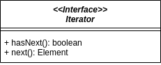

# Iterator (Itérateur)

> 🤖 Rédaction assistée par IA.

## Problème

Nous souhaitons **parcourir les éléments d'une collection sans dépendre de sa structure interne** (tableau, liste chaînée, arbre...).

## Solution

Le principe consiste à :

* **Définir une interface `Iterator`** offrant les opérations de parcours (`hasNext()` et `next()`)
* **Fournir un itérateur pour chaque collection** (ex : méthode `iterator()`), implémenté en fonction de sa structure interne
* **Écrire les traitements en s'appuyant uniquement sur l'itérateur**



## Variantes

Nous trouverons plusieurs variantes d'itérateurs :

* Un itérateur avec une méthode `reset()` permettant de **reprendre le parcours au début**
* Un itérateur inverse (`ReverseIterator`) permettant un **parcours en sens inverse**
* Un itérateur circulaire (ex : [Circulator](https://doc.cgal.org/latest/Circulator/index.html) dans CGAL) permettant un **parcours sans début ni fin** (ex : sommets d'un polygone)

Il existe par ailleurs **plusieurs styles d'interfaces pour parcourir des éléments** (itérateur, générateur, flux...). Le patron [Adapter](../structure/Adapter.md) permettra de passer de l'un à l'autre (ex : [`ReadableStream.from(iterator)`](https://developer.mozilla.org/en-US/docs/Web/API/ReadableStream/from_static) en JavaScript).

## Mises en garde

* Le patron Iterator est [intégré à la plupart des langages](../specificites-langages/index.md#les-patrons-integres) et exploité par les boucles : nous nous appuierons sur ces mécanismes plutôt que de définir nos propres interfaces. Par exemple, en TypeScript, avec un **générateur** :

    ```ts
    interface ListNode<T> {
        value: T;
        next?: ListNode<T>;
    }

    class LinkedList<T> implements Iterable<T> {
        private first?: ListNode<T>;

        *[Symbol.iterator](): Iterator<T> {
            for (let node = this.first; node; node = node.next) {
                yield node.value;
            }
        }
    }

    for (const item of list) {
        console.log(item);
    }
    ```

* La **modification d'une collection pendant son parcours** est source d'erreurs (ex : `ConcurrentModificationException` en Java). Il convient de s'appuyer sur les méthodes prévues à cet effet (ex : `Iterator.remove()` en Java) ou de construire une nouvelle collection.
* Un itérateur est généralement **à usage unique** : une fois le parcours terminé, il faudra demander un nouvel itérateur à la collection pour la parcourir à nouveau.

## Liens utiles

* [refactoring.guru - Iterator](https://refactoring.guru/fr/design-patterns/iterator)
* [fr.wikibooks.org - Itérateur](https://fr.wikibooks.org/wiki/Patrons_de_conception/It%C3%A9rateur)

Voir aussi :

* [Iterator](https://docs.oracle.com/en/java/javase/21/docs/api/java.base/java/util/Iterator.html) pour Java
* [Les protocoles d'itération](https://developer.mozilla.org/fr/docs/Web/JavaScript/Reference/Iteration_protocols) et les [générateurs](https://developer.mozilla.org/fr/docs/Web/JavaScript/Reference/Global_Objects/Generator) pour JavaScript
* [Les types itérateurs](https://docs.python.org/fr/3/library/stdtypes.html#iterator-types) pour Python
* [Traversable](https://www.php.net/manual/fr/class.traversable.php) et [les itérables](https://www.php.net/manual/fr/language.types.iterable.php) pour PHP
