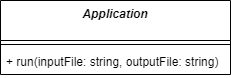
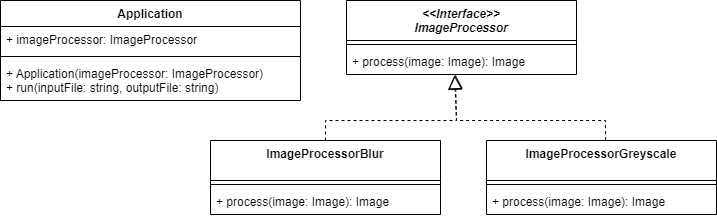
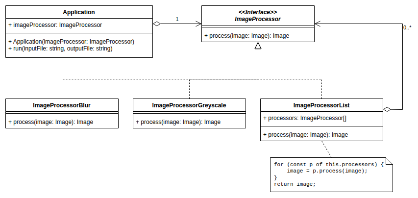

# Strategy

## Problème

Nous souhaitons pouvoir **faire varier dynamiquement le comportement d'une partie d'un traitement**.

## Cas d'école

Prenons le cas d'une **application de traitement d'image** qui applique les trois étapes suivantes :

* Charger une image PNG à partir d'un fichier (`inputFile`)
* Flouter l'image (`blur`)
* Sauvegarder l'image dans un fichier (`outputFile`)



Nous l'exposons en ligne de commande sous la forme suivante :

```bash
traitement-image data/joconde.jpg data/joconde-blur.jpg
```

> Voir [mborne/pattern-strategy-ts - branche initial](https://github.com/mborne/pattern-strategy-ts/tree/initial#readme)

Nous souhaitons **faire évoluer l'application pour permettre** :

* Le **choix entre plusieurs opérations**
    * Flouter l'image (`blur`)
    * Convertir l'image en niveau de gris (`greyscale`)
* Le **chaînage des opérations** (`blur,greyscale`) pour lequel l'utilisation de [Template Method](TemplateMethod.md#mises-en-garde) a montré des limites.

```text
traitement-image {inputFile} {outputFile} {operation}[,{operation}...]
```

## Solution

Avec le **patron Strategy**, nous allons **encapsuler le traitement dans un objet dont le seul rôle se limitera à appliquer le traitement** (`ImageProcessor`) :



Pour enchaîner les traitements (ex : `blur,greyscale`), nous pourrons par exemple exploiter le patron de conception [Composite](../structure/Composite.md) en modélisant une liste de traitements sous forme d'une `ImageProcessorList` :




## Exemple d'implémentation

Voir [mborne/pattern-strategy-ts - branche strategy](https://github.com/mborne/pattern-strategy-ts/tree/strategy#readme)

## Liens utiles

* [fr.wikibooks.org - Stratégie](https://fr.wikibooks.org/wiki/Patrons_de_conception/Strat%C3%A9gie)
* [refactoring.guru - Stratégie](https://refactoring.guru/fr/design-patterns/strategy)
