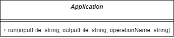
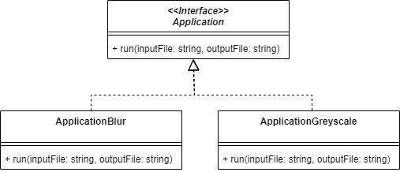
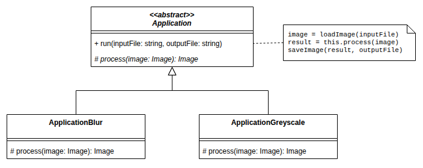

# Template Method (Patron de méthode)

> 🤖 Rédaction assistée par IA.

## Problème

Nous souhaitons **partager le squelette d'un traitement** entre plusieurs variantes en ne **faisant varier que certaines étapes**.

## Cas d'école

!!! warning "Un cas d'école volontairement limitant"
    Ce cas d'école est le même que celui du patron [Strategy](Strategy.md). Il a été choisi pour **comparer les deux approches** et Template Method y montre rapidement ses limites (voir [Mises en garde](#mises-en-garde)). Ce n'est pas le cas d'usage où ce patron est le plus pertinent.

Prenons le cas d'une **application de traitement d'image** qui applique les trois étapes suivantes :

* Charger une image PNG à partir d'un fichier (`inputFile`)
* Flouter l'image (`blur`)
* Sauvegarder l'image dans un fichier (`outputFile`)


Nous l'exposons en ligne de commande sous la forme suivante :

```bash
traitement-image data/joconde.jpg data/joconde-blur.jpg
```

> Voir [mborne/pattern-strategy-ts - branche initial](https://github.com/mborne/pattern-strategy-ts/tree/initial#readme)

Nous souhaitons **faire évoluer l'application pour permettre le choix entre plusieurs opérations** :

* Flouter l'image (`blur`)
* Convertir l'image en niveau de gris (`greyscale`)

Nous ciblons pour cela l'**ajout d'un paramètre à l'API en ligne de commande** comme suit :

```text
traitement-image {inputFile} {outputFile} (blur|greyscale)
```

## Solutions exclues

### Se contenter de l'ajout d'un paramètre

Nous pourrions nous contenter d'ajouter un paramètre à la méthode `run` et traiter les différents cas en fonction `operationName` :



Cette approche serait la plus simple mais elle possède plusieurs défauts :

* Ajouter un algorithme impliquera la mise à jour de `run` (violation du principe ouvert/fermé)
* La classe `Application` aura tendance à devenir un **objet divin**.
* En particulier, nous risquons à terme de multiplier les attributs spécifiques aux différents traitements (ex : `blurRadius`) sur la classe `Application`.

Nous pourrions nous contenter d'ajouter un paramètre à la méthode `run` et traiter les différents cas en fonction `operationName` :



Cette approche serait la plus simple mais elle possède plusieurs défauts :

* Ajouter un algorithme impliquera la mise à jour de `run` (violation du principe ouvert/fermé)
* La classe `Application` aura tendance à devenir un **objet divin**.
* En particulier, nous risquons à terme de multiplier les attributs spécifiques aux différents traitements (ex : `blurRadius`) sur la classe `Application`.


### Se contenter de créer des instances dérivées de la classe application

Nous pourrions promouvoir `Application` en interface et nous appuyer sur le polymorphisme comme suit :


A première vue, nous pourrions être satisfait d'une telle conception... Toutefois, nous répéterions le code de lecture et d'écriture les classes dérivées.

> Voir [mborne/pattern-strategy-ts - branche heritage](https://github.com/mborne/pattern-strategy-ts/tree/heritage#readme)


## Solution

Avec *template method*, le principe consiste à :

* **Définir le squelette du traitement dans une méthode de la classe parente** (`run`) qui enchaîne les étapes
* **Déclarer abstraites les étapes qui varient** (`process`)
* **Redéfinir ces étapes dans les classes filles** (`ApplicationBlur`, `ApplicationGreyscale`)




## Exemple d'implémentation

```ts
abstract class Application {
    // le squelette du traitement
    run(inputFile: string, outputFile: string): void {
        const image = loadImage(inputFile);
        const result = this.process(image);
        saveImage(result, outputFile);
    }

    // l'étape qui varie
    protected abstract process(image: Image): Image;
}

class ApplicationBlur extends Application {
    protected process(image: Image): Image {
        return blur(image, 5);
    }
}

class ApplicationGreyscale extends Application {
    protected process(image: Image): Image {
        return greyscale(image);
    }
}
```

## Mises en garde

Le patron Template Method s'appuie sur l'**héritage**, ce qui présente plusieurs limites :

* **Choix figé à la compilation** : l'opération est déterminée par la classe instanciée et ne peut être modifiée à l'exécution.
* **Couplage fort** entre la classe parente et ses classes filles : une modification du squelette impacte toutes les variantes.
* **Que se passe-t'il si nous souhaitons maintenant pouvoir appliquer deux traitements successifs?** Nous avons soit :
    * Une **explosion combinatoire** (`ApplicationBlur`, `ApplicationGreyscale`, `ApplicationGreyscaleBlur`, `ApplicationBlurGreyscale`)
    * Des écritures/relectures multiples de fichiers si nous nous écrivons dans un fichier temporaire.

Le problème de fond réside dans le fait que **nous ne respectons pas plusieurs principes de conception** :

* Le **principe de responsabilité unique** (`Application` assure le calcul ainsi que l'orchestration de la lecture et les écritures des fichiers).
* **Privilégier la composition à l'héritage s'applique aussi pour l'encapsulation des traitements**.

Le patron [Strategy](Strategy.md) lève ces limites en **encapsulant l'étape qui varie dans un objet dédié**.

Template Method reste adapté lorsque **les variantes sont peu nombreuses et ne se combinent pas**. Il est notamment très utilisé par les frameworks (ex : classe abstraite à étendre en redéfinissant des méthodes permettant d'opérer des variations légères (ex : générer le SQL de sélection d'une géométrie en GeoJSON en fonction du SGBD)).

## Liens utiles

* [fr.wikipedia.org - Patron de méthode](https://fr.wikipedia.org/wiki/Patron_de_m%C3%A9thode)
* [refactoring.guru - Patron de méthode](https://refactoring.guru/fr/design-patterns/template-method)
