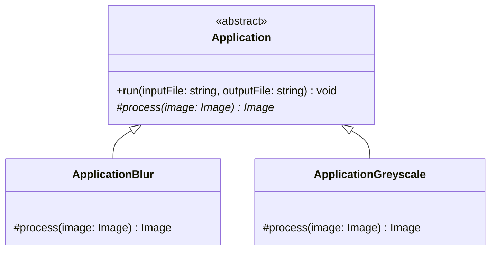

# Template Method (Patron de méthode)

> 🤖 Rédaction assistée par IA.

## Problème

Nous souhaitons **partager le squelette d'un traitement** entre plusieurs variantes en ne **faisant varier que certaines étapes**.

## Cas d'école

Reprenons le cas de l'**application de traitement d'image** utilisé pour [Strategy](Strategy.md) qui applique les trois étapes suivantes :

* Charger une image à partir d'un fichier (`inputFile`)
* Appliquer une opération sur l'image (ex : `blur`)
* Sauvegarder l'image dans un fichier (`outputFile`)

Nous souhaitons **permettre le choix entre plusieurs opérations** (`blur` ou `greyscale`) sans dupliquer le chargement et la sauvegarde.

## Solution

Le principe consiste à :

* **Définir le squelette du traitement dans une méthode de la classe parente** (`run`) qui enchaîne les étapes
* **Déclarer abstraites les étapes qui varient** (`process`)
* **Redéfinir ces étapes dans les classes filles** (`ApplicationBlur`, `ApplicationGreyscale`)



Par exemple, en TypeScript :

```ts
abstract class Application {
    // le squelette du traitement
    run(inputFile: string, outputFile: string): void {
        const image = loadImage(inputFile);
        const result = this.process(image);
        saveImage(result, outputFile);
    }

    // l'étape qui varie
    protected abstract process(image: Image): Image;
}

class ApplicationBlur extends Application {
    protected process(image: Image): Image {
        return blur(image, 5);
    }
}

class ApplicationGreyscale extends Application {
    protected process(image: Image): Image {
        return greyscale(image);
    }
}
```

La classe parente peut aussi fournir des **méthodes crochets (*hooks*)** avec un comportement par défaut que les classes filles redéfinissent si besoin (ex : `beforeProcess()` ne faisant rien par défaut).

## Mises en garde

Le patron Template Method s'appuie sur l'**héritage**, ce qui présente plusieurs limites :

* **Explosion combinatoire** : si nous souhaitons enchaîner les opérations, nous devrons créer une classe par combinaison (`ApplicationBlurGreyscale`, `ApplicationGreyscaleBlur`...).
* **Choix figé à la compilation** : l'opération est déterminée par la classe instanciée et ne peut être modifiée à l'exécution.
* **Couplage fort** entre la classe parente et ses classes filles : une modification du squelette impacte toutes les variantes.
* **Responsabilités mêlées** : `Application` assure à la fois l'orchestration (lecture et écriture des fichiers) et le calcul (via ses classes filles).

Ces limites illustrent le principe **privilégier la composition à l'héritage**. Le patron [Strategy](Strategy.md) les lève en **encapsulant l'étape qui varie dans un objet dédié**.

Template Method reste adapté lorsque **les variantes sont peu nombreuses et ne se combinent pas**. Il est notamment très utilisé par les frameworks (ex : classe abstraite à étendre en redéfinissant des méthodes crochets).

## Liens utiles

* [fr.wikipedia.org - Patron de méthode](https://fr.wikipedia.org/wiki/Patron_de_m%C3%A9thode)
* [refactoring.guru - Patron de méthode](https://refactoring.guru/fr/design-patterns/template-method)
