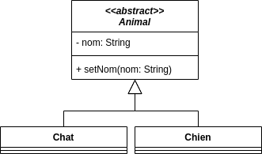
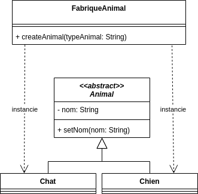
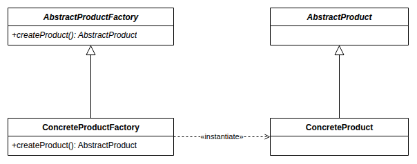
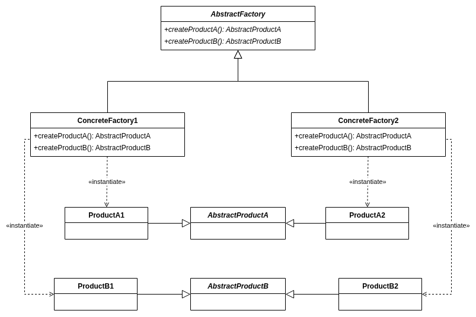

# Factory (Fabrique)

## Problème

Dans sa forme la plus simple, la fabrique répond au problème de la **création d'instances de classes dérivées**. Nous verrons qu'elle admet plusieurs variantes.

## Cas d'école

Nous avons par exemple la hiérarchie suivante :



Supposons que nous devons créer des instances de la classe Animal dans plusieurs parties de l'application (chargement à partir d'un fichier CSV, à partir d'une requête sur une API...).

À chaque fois, nous devrons faire appel à "new" en fonction du type de l'animal :

```ts
let animal: Animal ;
if ( typeAnimal == "chat" ){
    animal = new Chat() ;
}else if (typeAnimal == "chien"){
    animal = new Chien() ;
}else{
    throw new AnimalTypeNotFound(typeAnimal);
}
animal.setNom(nomAnimal);
```

**En cas d'ajout d'un type d'animal, nous devrons modifier tous les codes créant des animaux.**

## Solution

Nous pouvons définir une **classe avec une méthode dédiée à la création des instances** en fonction d'un type :



Le **code gérant la logique de création en fonction du type sera localisé dans cette fabrique** :

```ts
class FabriqueAnimal {
    public createAnimal(typeAnimal: string): Animal {
        if ( typeAnimal == "chat" ){
            return new Chat() ;
        }else if (typeAnimal == "chien"){
            return new Chien() ;
        }else{
            throw new AnimalTypeNotFound(typeAnimal);
        }
    }
}
```

Il sera alors **possible d'ajouter un type sans modifier les codes faisant appel à cette fabrique** (seule la fabrique sera à modifier) :

```ts
const animal = FabriqueAnimal.createAnimal(typeAnimal) ;
animal.setNom(nomAnimal);
```

## Variantes

Nous trouverons de nombreuses variantes du concept de fabrique.

### La fabrique statique

La méthode de création est une méthode statique :

```ts
FabriqueAnimal.createByType("chien")
```

Son intérêt réside dans le fait qu'il n'est pas nécessaire d'instancier une fabrique. En contrepartie :

* Il n'est pas possible de **la remplacer**, par exemple par une fabrique de test[^static-mock].
* Il est plus délicat de **faire varier son comportement** : une méthode statique ne se redéfinit pas dans une classe fille (pas de polymorphisme).
* Il est plus délicat d'y **stocker un état** (ex : registre de modèles, paramètres de connexion) : il serait global, donc partagé par toute l'application, avec les mêmes travers qu'un [Singleton](Singleton.md).

[^static-mock]: En réalité, cette possibilité dépend du langage et des outils. En TypeScript, une méthode statique peut être remplacée à l'exécution (ex : `jest.spyOn(AnimalFactory, "createAnimal")`). En Java, il faut recourir à des outils spécifiques (ex : `Mockito.mockStatic`).

### La fabrique par copie d'un modèle

Il est possible de combiner le patron fabrique et le patron [Prototype](Prototype.md) pour créer des instances par copie d'un modèle d'instance.

### Les fabriques utilitaires

Ces fabriques ne créent pas des instances de types différents, mais avec des états initiaux différents :

```ts
FractalFactory.createSierpinskiTriangles(8);
```

### Factory Method (GoF)

Avec ce patron du GoF, **une classe délègue à ses sous-classes le choix du type créé** :



Une classe cliente peut ainsi appeler `createProduct()` sur une fabrique sans connaître son type concret, ni celui de l'objet créé.

En pratique, on se retrouve souvent à devoir créer plusieurs objets liés : on bascule alors vers le patron suivant, dont les fabriques concrètes s'appuient sur des *factory methods*.

### Abstract Factory (GoF)

Avec ce patron du GoF, **le choix de la fabrique déterminera la famille des objets créés** :



Cas d'école :

* Des **composants d'interface pour plusieurs design systems** produisant des structures HTML différentes (`Bouton`, `Formulaire`, `Menu` en version [DSFR](https://www.systeme-de-design.gouv.fr/) ou *design system IGN*).
* L'**accès à plusieurs SGBD** (`Connexion`, `Requete`, `Resultat` pour PostgreSQL ou SQLite).
* **Plusieurs bibliothèques de traitements géométriques** (`Point`, `LineString`, `Polygon` s'appuyant sur [JSTS](https://github.com/bjornharrtell/jsts) ou [Turf.js](https://turfjs.org/)).
* **Plusieurs modèles de graphe** (`Vertex`, `Edge` en version orientée ou non orientée via `DirectedGraphFactory` / `UndirectedGraphFactory`).

## Liens utiles

* [fr.wikibooks.org - Fabrique](https://fr.wikibooks.org/wiki/Patrons_de_conception/Fabrique)
* [fr.wikibooks.org - Fabrique abstraite - exemple avec des widgets d'interface WIN32 et OSX](https://fr.wikibooks.org/wiki/Patrons_de_conception/Fabrique_abstraite)
* [refactoring.guru - Fabrique abstraite](https://refactoring.guru/fr/design-patterns/abstract-factory)
* [stackoverflow.com - Factory vs Factory method vs Abstract Factory](https://stackoverflow.com/questions/13029261/design-patterns-factory-vs-factory-method-vs-abstract-factory)
