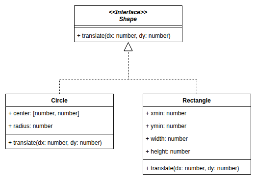
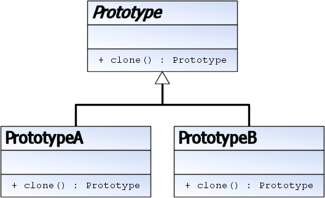
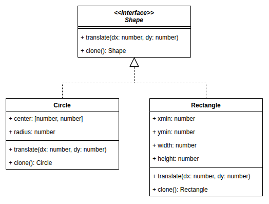

# Prototype

> 🤖 Rédaction assistée par IA.

## Problème

Nous souhaitons **copier un objet sans connaître sa classe concrète**.

## Cas d'école

Dans un éditeur, nous manipulons des formes (`Shape`) qui peuvent être des cercles (`Circle`) ou des rectangles (`Rectangle`) :



Nous devons écrire une fonction qui renvoie une copie translatée d'une forme, **sans modifier la forme d'origine**. Sans précaution particulière, nous devrons tester le type de la forme pour appeler le bon constructeur :

```ts
function translated(shape: Shape, dx: number, dy: number): Shape {
    let copy: Shape;
    if (shape instanceof Circle) {
        copy = new Circle([...shape.center], shape.radius);
    } else if (shape instanceof Rectangle) {
        copy = new Rectangle(shape.xmin, shape.ymin, shape.width, shape.height);
    } else {
        throw new Error("type de forme non supporté");
    }
    copy.translate(dx, dy);
    return copy;
}
```

**En cas d'ajout d'un type de forme, nous devrons modifier tous les codes réalisant des copies.**

## Solution

Le principe consiste à :

* **Déclarer une méthode `clone()`** dans l'interface (ou la classe abstraite) commune
* **Implémenter `clone()` dans chaque classe concrète** pour renvoyer une copie conforme de l'instance
* **Appeler `clone()` sans connaître le type concret** de l'objet copié



Source : [fr.wikibooks.org - Patrons de conception/Prototype](https://fr.wikibooks.org/wiki/Patrons_de_conception/Prototype)

## Exemple d'implémentation

Pour notre cas d'école, nous ajoutons une méthode `clone()` à l'interface `Shape` :



```ts
interface Shape {
    translate(dx: number, dy: number): void;
    clone(): Shape;
}

class Circle implements Shape {
    constructor(public center: [number, number], public radius: number) {}

    translate(dx: number, dy: number): void {
        this.center[0] += dx;
        this.center[1] += dy;
    }

    clone(): Circle {
        // copie du tableau (sinon, il serait partagé entre les deux cercles)
        return new Circle([...this.center], this.radius);
    }
}

class Rectangle implements Shape {
    constructor(
        public xmin: number,
        public ymin: number,
        public width: number,
        public height: number
    ) {}

    translate(dx: number, dy: number): void {
        this.xmin += dx;
        this.ymin += dy;
    }

    clone(): Rectangle {
        return new Rectangle(this.xmin, this.ymin, this.width, this.height);
    }
}
```

La fonction de translation ne dépend alors plus des types concrets :

```ts
function translated(shape: Shape, dx: number, dy: number): Shape {
    const copy = shape.clone();
    copy.translate(dx, dy);
    return copy;
}
```

## Mises en garde

* L'**implémentation de `clone()` est délicate !** Une **copie superficielle** (*shallow copy*) partage les objets référencés par l'original (ex : sans `[...this.center]`, translater la copie d'un cercle déplacerait aussi l'original)
* Il convient de réaliser une **copie profonde** (*deep copy*) des seuls membres modifiables après construction : les [objets immuables](https://docs.oracle.com/javase/tutorial/essential/concurrency/immutable.html) peuvent être partagés sans risque
* La copie est souvent [intégrée au langage](../specificites-langages/index.md#les-patrons-integres) et le patron Prototype ne sera pas toujours le plus adapté (ex : en Java, la méthode `clone()` héritée de `Object` est réputée délicate à utiliser et *Effective Java* recommande de lui préférer un constructeur de copie)
* Si l'objet n'a pas vocation à être modifié, il est plus simple de le rendre **immuable** : les méthodes renvoient alors une nouvelle instance (ex : `translate(dx, dy)` renvoie un nouveau `Circle`) et la copie devient inutile

## Liens utiles

* [refactoring.guru - Prototype](https://refactoring.guru/fr/design-patterns/prototype)
* [fr.wikibooks.org - Prototype](https://fr.wikibooks.org/wiki/Patrons_de_conception/Prototype)

Voir aussi :

* [La fabrique par copie d'un modèle](Factory.md#la-fabrique-par-copie-dun-modele) qui combine Factory et Prototype
* [TP - Geometry.clone()](../tp-geometry-ts/index.md#04-geometryclone) pour une mise en pratique
* [structuredClone](https://developer.mozilla.org/en-US/docs/Web/API/structuredClone) pour JavaScript (copie profonde des données, **sans conserver la classe**)
* [copy](https://docs.python.org/fr/3/library/copy.html) pour Python
