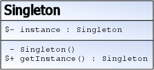

# Singleton

> 🤖 Rédaction assistée par IA.

## Problème

Nous avons une classe qui **ne doit être instanciée qu'une seule fois** et dont l'**instance doit être accessible depuis n'importe quelle partie de l'application**.

## Cas d'école

Nous souhaitons disposer d'un compteur global à l'application pour générer des identifiants uniques. **Si plusieurs instances de ce compteur coexistent, elles généreront des doublons.**

## Solution

Le principe consiste à :

* **Rendre le constructeur privé** pour interdire la création d'instances depuis l'extérieur de la classe
* **Stocker l'instance unique dans un attribut statique**
* **Fournir une méthode statique renvoyant cette instance**



Source : [fr.wikibooks.org - Patrons de conception/Singleton](https://fr.wikibooks.org/wiki/Patrons_de_conception/Singleton)

## Exemple d'implémentation

Pour notre cas d'école, nous pouvons définir un singleton `Sequence` permettant de récupérer le prochain identifiant :

```ts
class Sequence {
    private static _instance: Sequence = new Sequence();

    private _current = 0;

    private constructor() {}

    static getInstance(): Sequence {
        return Sequence._instance;
    }

    next(): number {
        return this._current++;
    }
}
```

À l'utilisation, nous aurons :

```ts
const sequence = Sequence.getInstance();
console.log(sequence.next()); // 0
console.log(sequence.next()); // 1
```

## Mises en garde

* **La singletonite est un anti-patron** :
    * La tentation est grande de l'utiliser pour disposer d'un accès statique à une instance
    * Les problèmes sont ceux d'une variable globale
* Il convient de **réserver le singleton aux cas où l'instance <u>doit être</u> unique**
* L'utilisation d'un singleton rend le **code moins flexible** (ex : `Camera.getInstance()` dans un jeu 3D imposerait la présence d'une seule caméra) et **plus difficilement testable** (dépendance cachée, état partagé entre les tests, substitution par un mock délicate)
* Pour partager une instance unique sans accès statique, il est préférable de recourir à l'**[injection de dépendances](../architecturaux/index.md)** : l'instance est créée une seule fois au démarrage et transmise aux classes qui en ont besoin (ex : portée *singleton* des conteneurs IoC d'Angular, Symfony, Spring…)
* Il existe plusieurs [variantes d'implémentation](#variantes)
* Avec certains langages (ex : Java), l'[instanciation paresseuse](#instanciation-paresseuse-lazy-loading) doit être rendue *thread safe* (voir [thecodersbreakfast.net - De la bonne implémentation du Singleton en Java](https://thecodersbreakfast.net/index.php?post/2008/02/25/26-de-la-bonne-implementation-du-singleton-en-java))

## Variantes

### Instanciation paresseuse (*lazy loading*)

Dans l'exemple ci-dessus, l'instance est créée dès le chargement de la classe. Une variante consiste à la **créer au premier appel** de `getInstance()` :

```ts
class Sequence {
    private static _instance?: Sequence;

    private _current = 0;

    private constructor() {}

    static getInstance(): Sequence {
        if (!Sequence._instance) {
            Sequence._instance = new Sequence();
        }
        return Sequence._instance;
    }

    next(): number {
        return this._current++;
    }
}
```

### Objets globaux

En JavaScript, les API des navigateurs exposent souvent leurs instances uniques sous forme de propriétés d'objets globaux (ex : [navigator.geolocation](https://developer.mozilla.org/en-US/docs/Web/API/Navigator/geolocation) pour l'[API de géolocalisation](https://developer.mozilla.org/en-US/docs/Web/API/Geolocation)).

### Unicité au niveau d'un module

En JavaScript et TypeScript, il sera plus naturel d'**assurer l'unicité de la construction au niveau d'un module** plutôt que de recourir à un constructeur privé. Un module n'étant chargé qu'une seule fois, toutes les parties de l'application qui l'importent partageront la même instance.

Pour reprendre l'exemple de la `Sequence` (ici dotée d'un constructeur public) :

```ts
// helpers/globalSequence.ts - instance globale unique de Sequence
const globalSequence: Sequence = new Sequence();
export default globalSequence;
```

## Liens utiles

* [fr.wikibooks.org - Singleton](https://fr.wikibooks.org/wiki/Patrons_de_conception/Singleton)
* [refactoring.guru - Singleton](https://refactoring.guru/fr/design-patterns/singleton)
* [refactoring.guru - Singleton in TypeScript](https://refactoring.guru/design-patterns/singleton/typescript/example)
* [thecodersbreakfast.net - De la bonne implémentation du Singleton en Java](https://thecodersbreakfast.net/index.php?post/2008/02/25/26-de-la-bonne-implementation-du-singleton-en-java)
