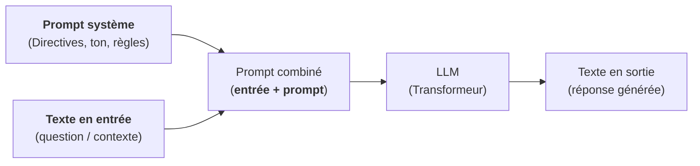
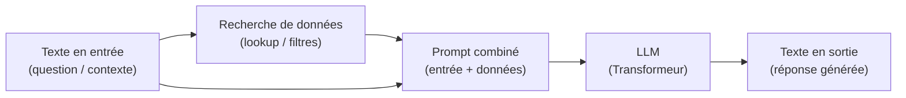

---
tags:
    - LLM
    - Techniques avancées
    - RAG
    - Tool calling
---

# Les LLM - Concepts avancés

## Le prompt système

Le **prompt système** est un texte préposé devant le texte en entrée afin d'orienter la réponse :

## Le RAG (Retrieved Augmented Generation)

Le **RAG (Retreived Augmented Generation)** est une technique consistant à **rechercher des données en fonction du texte en entrée** avant de demander au LLM de **produire la réponse finale** :

Il convient de souligner que **la recherche des données est traitée au niveau de l'applicatif** exploitant un LLM et qu'**il y a plusieurs approches possibles pour récupérer les données utiles** :

- Faire une **recherche sémantique** dans une base vectorielle après conversion du texte en entrée en vecteur sémantique (*embedding*).
- Faire une **recherche full-texte** après extraction de mots clés à partir du texte en entrée.
- Faire une **requête SQL** ou un **appel d'API** après extraction des paramètres à partir du texte en entrée (ex : `theme`)
- ...

## Le *tool calling*

Dans le cas du *tool calling*, le LLM reçoit le texte en entrée et une description des outils disponibles (nom, description, paramètres). Il peut alors :

- Demander d'appeler un ou plusieurs outils
- Extraire les paramètres pour chaque appel

**La réponse finale est produite à partir du texte en entrée et du résultat des appels des outils**.

Par exemple, pour la question "Quelle heure est-il ?" :

- Le LLM identifie qu'il doit appeler l'outil `get_current_time()`
- L'application traite l'appel et fournit l'heure au LLM pour la génération de la réponse finale.

Pour la question "quelle est l'altitude de la tour Eiffel", il pourra demander l'appel à `geocode("tour Eiffel") -> [2.94694, 48.858093]` puis à `altitude(2.94694, 48.858093)`.

Nous noterons que :

- **Les appels d'outil sont traités au niveau de l'application**.
- Tous les modèles ne supportent pas le *tool calling* (voir [docs.ollama.com - Capabilities - Tool calling](https://docs.ollama.com/capabilities/tool-calling) et [modèles avec le tag "tools"](https://ollama.com/search))
- Les outils peuvent prendre la forme de **fonctions développées dans le même langage que l'application**.
- En alternative, [MCP (Model Context Protocol)](../mcp/index.md) permet de **standardiser la mise à disposition de ces outils** sous forme de service.

## RAG vs Tool Calling

- Le RAG peut être traité sous forme d'un appel d'outil (ex : `recherche(keywords)`)
- **L'appel d'outil offre plus de possibilités que le RAG : Appel d'API, création de fichiers, exécution de commande...**
