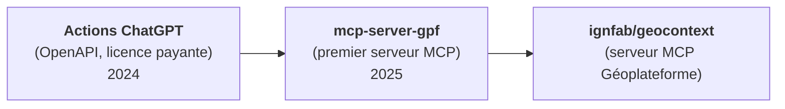

---
tags:
    - LLM
    - MCP
    - Données géographiques
---

# Les LLM - Retours d'expérimentations

Cette page reprend les enseignements de quelques expérimentations réalisées en 2024 et 2025 sur l'utilisation des LLM avec les données et services géographiques de l'IGN (dépôt archivé [mborne/llm-experimentations](https://github.com/mborne/llm-experimentations#readme)).

> ⚠️ **Mise en garde** : les constats datent principalement de 2024 et ont été faits avec ChatGPT (GPT-4o). Les modèles progressent et la recherche web est désormais souvent activée par défaut : **les phénomènes observés sont à revérifier avec les modèles actuels**.

## Points clés

- Un LLM n'est **pas un géocodeur** : il faut lui donner accès à un véritable service de géocodage.
- Il faut **s'appuyer sur des données de référence** plutôt que sur la mémoire du modèle.
- La **qualité des spécifications OpenAPI** conditionne l'usage des API par les LLM.
- L'intégration des API est passée des **actions ChatGPT** aux **serveurs MCP**.

## Besoin d'un véritable service de géocodage

Sans service dédié, la précision du géocodage réalisé par ChatGPT est variable (voir [ChatGPT - les limites des capacités de géocodage par défaut](https://github.com/mborne/llm-experimentations/blob/main/chatgpt-geocodage-limites/README.md)) :

| Cas testé | Constat |
| --------- | ------- |
| Monument (tour Eiffel), ville (Besançon) | Position précise |
| Village (Loray) | **Plusieurs kilomètres d'écart** |
| Adresse (site IGN de Saint-Mandé) | **Plus de 100 m d'écart** |

La **recherche web ne remplace pas un géocodeur** :

- Le modèle agrège des coordonnées trouvées sur différentes sources web (il n'appelle pas un service de géocodage).
- Pour l'adresse de l'IGN, les sources sont cohérentes entre elles mais présentent un **biais d'environ 500 m**.
- Demander explicitement une recherche web **dégrade encore la précision**.

L'appel au [service d'autocomplétion de la Géoplateforme](https://geoservices.ign.fr/documentation/services/services-geoplateforme/autocompletion) **corrige ces cas** (adresse IGN, village de Loray, mairie de Vincennes). Voir [ChatGPT - intégration du service de géocodage de la Géoplateforme](https://github.com/mborne/llm-experimentations/blob/main/chatgpt-geocodage-gpf/README.md).

## S'appuyer sur des données de référence

Les réponses produites à partir de la seule mémoire du modèle sont **imprécises voire incohérentes** :

- Le **code postal d'une commune** est correct (Ornans → 25290), mais les **communes d'un code postal** sont erronées (25390) ([ChatGPT - Intégration du module APICARTO codes-postaux](https://github.com/mborne/llm-experimentations/blob/main/chatgpt-apicarto-codes-postaux/README.md)).
- La **population d'une commune** est imprécise tant que le modèle ne procède pas à une recherche web ([ChatGPT - recherche d'informations sur les communes](https://github.com/mborne/llm-experimentations/blob/main/chatgpt-communes/README.md)).

Pour obtenir une réponse fiable, il convient d'**enrichir le contexte avec des données de référence** avant la production de la réponse (ex : appel au [module codes-postaux d'APICARTO](https://apicarto.ign.fr/api/doc/codes-postaux) par [tool calling](../concepts/index.md#le-tool-calling)).

## La qualité des spécifications OpenAPI

Les LLM sont capables de **trouver et lire les spécifications OpenAPI** exposées sur internet pour générer du code client ([apicarto-codes-postaux](https://github.com/mborne/llm-experimentations/blob/main/apicarto-codes-postaux/README.md), [apicarto-aoc-viticole-v1](https://github.com/mborne/llm-experimentations/blob/main/apicarto-aoc-viticole-v1/README.md)).

La qualité de ces spécifications conditionne celle du code produit. Par exemple, avec des **codes d'erreur mal documentés** (400 pour un code postal mal formaté, 404 pour un code postal inconnu), le code généré ne distingue pas les erreurs et les présente toutes comme une erreur réseau.

> Voir [IGNF/apicarto#109 - Documentation - mise à jour des spécifications des API](https://github.com/IGNF/apicarto/issues/109).

## Historique de l'intégration d'API

- **Actions ChatGPT** (2024) : intégration d'une API à partir de ses spécifications OpenAPI (nécessite une licence payante, spécifique à ChatGPT).
- **[mcp-server-gpf](https://github.com/mborne/llm-experimentations/blob/main/mcp-server-gpf/README.md)** (2025) : premier test d'un serveur [MCP](../mcp/index.md) appelant le service d'autocomplétion de la Géoplateforme (ex : calcul de la distance entre Loray et Besançon par géocodage puis calcul de distance).
- **[ignfab/geocontext](https://github.com/ignfab/geocontext#readme)** : serveur MCP exploitant les services et données de la Géoplateforme.
