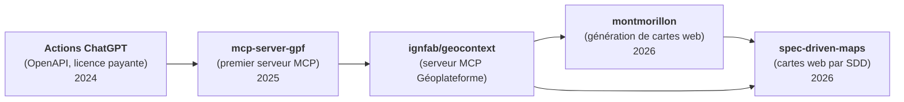

---
tags:
    - LLM
    - MCP
    - Données géographiques
---

# Les LLM - Retours d'expérimentations

Cette page reprend les enseignements de quelques expérimentations réalisées en 2024 et 2025 sur l'utilisation des LLM avec les données et services géographiques de l'IGN (dépôt archivé [mborne/llm-experimentations](https://github.com/mborne/llm-experimentations#readme)).

> ⚠️ **Mise en garde** : Certains constats datent principalement de 2024 et ont été faits avec ChatGPT (GPT-4o). Les modèles progressent et la recherche web est désormais souvent activée par défaut : **les phénomènes observés sont à revérifier avec les modèles actuels**.

## Points clés

- Un LLM n'est **pas un géocodeur** : il faut lui donner accès à un véritable service de géocodage.
- Il faut **s'appuyer sur des données de référence** plutôt que sur la mémoire du modèle.
- L'intégration des API est passée des **actions ChatGPT** aux **serveurs MCP**.
- Les services conçus pour les besoins cartographiques (ex : WFS, APICARTO...) ne sont **pas forcément adaptés à une utilisation par des LLM** (d'où le serveur MCP [ignfab/geocontext](https://github.com/ignfab/geocontext#readme)).
- Une fois l'accès aux données fourni, il est possible de **générer des cartes web** (ex : [montmorillon](https://github.com/mborne/montmorillon#readme), [spec-driven-maps](https://github.com/mborne/spec-driven-maps#readme)).

## Historique

- **Actions ChatGPT** (2024-08-12) : intégration d'une API à partir de ses spécifications OpenAPI (nécessite une licence payante, spécifique à ChatGPT), approche remplacée depuis par les serveurs MCP. Testée avec :
    - le [service de géocodage de la Géoplateforme](https://github.com/mborne/llm-experimentations/blob/main/chatgpt-geocodage-gpf/README.md) ;
    - le [module codes-postaux d'APICARTO](https://github.com/mborne/llm-experimentations/blob/main/chatgpt-apicarto-codes-postaux/README.md).
- **[mcp-server-gpf](https://github.com/mborne/llm-experimentations/blob/main/mcp-server-gpf/README.md)** (2025-03-25) : premier test d'un serveur [MCP](../mcp/index.md) appelant le service d'autocomplétion de la Géoplateforme (ex : calcul de la distance entre Loray et Besançon par géocodage puis calcul de distance).
- **[ignfab/geocontext](https://github.com/ignfab/geocontext#readme)** : serveur MCP exploitant les services et données de la Géoplateforme.
- **[montmorillon](https://github.com/mborne/montmorillon#readme)** (2026-05-29) : démonstration de génération de cartes web par IA pour le Printemps des Cartes 2026 exploitant [ignfab/geocontext](https://github.com/ignfab/geocontext#readme) ([cartes en ligne](https://mborne.github.io/montmorillon/)).
- **[spec-driven-maps](https://github.com/mborne/spec-driven-maps#readme)** (2026-09-29) : reprise des cartes de montmorillon et nouvelles cartes avec une approche [Specification-Driven Development (SDD)](https://github.com/github/spec-kit/blob/main/spec-driven.md) ([cartes en ligne](https://mborne.github.io/spec-driven-maps/)) :
    - spécification de chaque carte (`spec.md`, `plan.md`, `tasks.md`) ;
    - accès aux données de la Géoplateforme via [ignfab/geocontext](https://github.com/ignfab/geocontext#readme).

## Besoin d'un véritable service de géocodage

Sans service dédié, la précision du géocodage réalisé par ChatGPT est variable (voir [ChatGPT - les limites des capacités de géocodage par défaut](https://github.com/mborne/llm-experimentations/blob/main/chatgpt-geocodage-limites/README.md) (2024-08-12)) :

| Cas testé | Constat |
| --------- | ------- |
| Monument (tour Eiffel), ville (Besançon) | Position précise |
| Village (Loray) | **Plusieurs kilomètres d'écart** |
| Adresse (site IGN de Saint-Mandé) | **Plus de 100 m d'écart** |

La **recherche web ne remplace pas un géocodeur** :

- Le modèle agrège des coordonnées trouvées sur différentes sources web (il n'appelle pas un service de géocodage).
- Pour l'adresse de l'IGN, les sources sont cohérentes entre elles mais présentent un **biais d'environ 500 m**.
- Demander explicitement une recherche web **dégrade encore la précision**.

L'appel au [service d'autocomplétion de la Géoplateforme](https://geoservices.ign.fr/documentation/services/services-geoplateforme/autocompletion) **corrige ces cas** (adresse IGN, village de Loray, mairie de Vincennes).

> Voir [ChatGPT - intégration du service de géocodage de la Géoplateforme](https://github.com/mborne/llm-experimentations/blob/main/chatgpt-geocodage-gpf/README.md) (2024-08-12).

## S'appuyer sur des données de référence

Les réponses produites à partir de la seule mémoire du modèle sont **imprécises voire incohérentes** :

- Le **code postal d'une commune** est correct (Ornans → 25290), mais les **communes d'un code postal** sont erronées (25390) ([ChatGPT - Intégration du module APICARTO codes-postaux](https://github.com/mborne/llm-experimentations/blob/main/chatgpt-apicarto-codes-postaux/README.md) (2024-08-12)).
- La **population d'une commune** est imprécise tant que le modèle ne procède pas à une recherche web ([ChatGPT - recherche d'informations sur les communes](https://github.com/mborne/llm-experimentations/blob/main/chatgpt-communes/README.md) (2024-08-12)).

Pour obtenir une réponse fiable, il convient d'**enrichir le contexte avec des données de référence** avant la production de la réponse (ex : appel au [module codes-postaux d'APICARTO](https://apicarto.ign.fr/api/doc/codes-postaux) par [tool calling](../concepts/index.md#le-tool-calling)).

## Des services conçus pour la cartographie

Les services existants ont été conçus pour les besoins cartographiques (ex : WFS, [APICARTO](https://apicarto.ign.fr/api/doc/)...) et ne sont **pas forcément adaptés à une utilisation par des LLM** :

- Les réponses sont volumineuses (géométries complètes) et coûteuses en *tokens*.
- Les paramètres sont techniques (filtres CQL, noms de couches, systèmes de coordonnées...).
- Une question simple nécessite souvent de combiner plusieurs appels (ex : géocodage puis recherche spatiale).

D'où l'intérêt d'une **surcouche dédiée** sous forme de serveur MCP proposant des outils de plus haut niveau (voir [ignfab/geocontext](https://github.com/ignfab/geocontext#readme)).

## Génération de cartes web

Avec un assistant de codage disposant d'un accès aux données (ex : [ignfab/geocontext](https://github.com/ignfab/geocontext#readme)), il est possible de produire des **cartes web sous forme de sites statiques** (ex : MapLibre GL JS, hébergement GitHub Pages).

### Génération à partir d'un prompt

Les cartes de [montmorillon](https://github.com/mborne/montmorillon#readme) (2026-05-29) ont été générées rapidement pour le Printemps des Cartes 2026 (carte d'accès, carte touristique, bâtiments en 3D). Leur reprise a mis en évidence plusieurs défauts :

- **Géométries approximatives** : rivière tracée à la main, Cité de l'Écrit figurée par un cercle, coordonnées estimées.
- **Informations non vérifiées** : statut de monument historique saisi à la main et parfois faux (le Vieux Pont ne figure pas dans la base Mérimée).
- **Données volatiles ou non ouvertes** : horaires, notes et avis issus de sites tiers.
- **Erreurs de rendu** : légende des hauteurs ne correspondant pas aux couleurs, bâtiments sans hauteur extrudés à 3 m sans le signaler.

### Génération avec une approche SDD

[spec-driven-maps](https://github.com/mborne/spec-driven-maps#readme) (2026-09-29) reprend ces cartes et en produit de nouvelles avec une approche [Specification-Driven Development (SDD)](https://github.com/github/spec-kit/blob/main/spec-driven.md). Chaque carte est un dossier contenant :

- `specs/spec.md` : **quoi et pourquoi** (demande, objectif, public, critères d'acceptation, décisions) ;
- `specs/plan.md` : **comment** (sources de données, traitements, symbologie, rendu) ;
- `specs/tasks.md` : les tâches de réalisation ;
- `README.md` : la carte, la méthode et un **prompt équivalent** permettant de commander directement une carte similaire.

Les points notables de cette approche sont les suivants :

- Les **données sont contrôlées avec le MCP** avant de choisir la symbologie (ex : répartition des hauteurs des bâtiments de la BD TOPO pour définir des classes adaptées).
- Les **données sont traçables** : chaque lieu est décrit par une référence à sa source (identifiant BD TOPO, notice Mérimée ou adresse géocodée) et un script produit un GeoJSON versionné (ou la page lit directement les tuiles vectorielles de la Géoplateforme).
- Les **critères d'acceptation** permettent de vérifier le résultat (ex : la légende correspond exactement à la coloration affichée).

| Carte | Description |
| ----- | ----------- |
| [commune-doubs](https://github.com/mborne/spec-driven-maps/tree/main/commune-doubs#readme) | Densité de population des communes du Doubs |
| [montmorillon-acces](https://github.com/mborne/spec-driven-maps/tree/main/montmorillon-acces#readme) | Carte d'accès au Printemps des Cartes 2026 |
| [montmorillon-tourisme](https://github.com/mborne/spec-driven-maps/tree/main/montmorillon-tourisme#readme) | Carte touristique de Montmorillon |
| [montmorillon-bdtopo-3d](https://github.com/mborne/spec-driven-maps/tree/main/montmorillon-bdtopo-3d#readme) | Bâtiments de Montmorillon en 3D |
| [vignobles](https://github.com/mborne/spec-driven-maps/tree/main/vignobles#readme) | Densité de vignoble par commune et vignes de la BD TOPO (en construction) |
