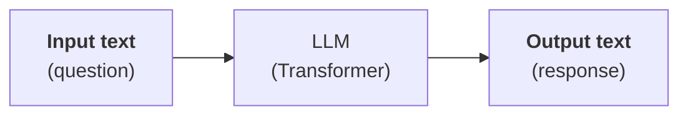

---
tags:
    - LLM
search:
    boost: 3
---

# Les LLM

## Points clés

- Un LLM produit un **texte en sortie à partir d'un texte en entrée** :

- Un LLM est sans état (pour les conversations, le texte en entrée est l'historique de la discussion + le nouveau message de l'utilisateur).
- Un LLM n'a pas d'accès aux données (plusieurs techniques permettent de récupérer les données utiles en amont de la production de la réponse : [RAG](concepts/index.md#le-rag-retrieved-augmented-generation), [tool calling](concepts/index.md#le-tool-calling),...)

## Pour aller plus loin

- [Principe de fonctionnement](principe/index.md) : réseau de neurones de type Transformeur, *tokens*, taille des modèles...
- [Concepts avancés](concepts/index.md) : prompt système, RAG, *tool calling*...
- [Techniques de rendu](rendu/index.md) : formatage markdown, cartographie, SIG...
- [Modèles locaux](modeles-locaux/index.md) : faire tourner des modèles en local (Ollama, Hugging Face)
- [Développement](developpement/index.md) : développer des applications (JavaScript, Python)
- [OKF (Open Knowledge Format)](okf/index.md) : format ouvert de représentation de la connaissance pour les humains et les agents
- [MCP (Model Context Protocol)](mcp/index.md) : standardisation de la mise à disposition d'outils
