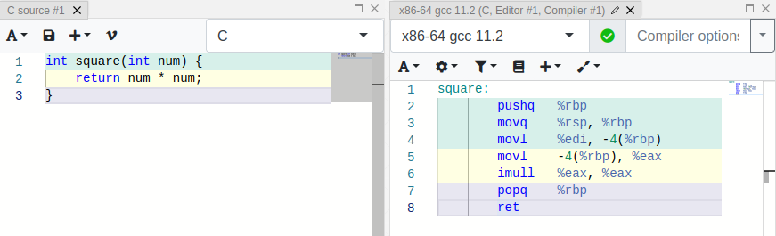
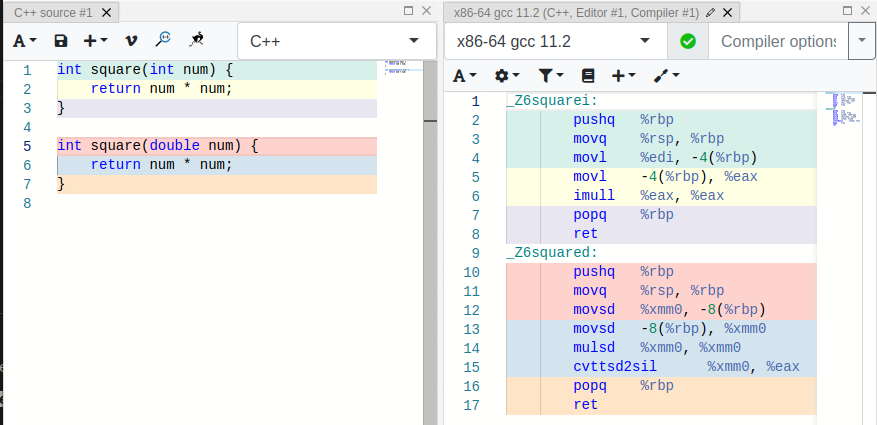

# La signature des fonctions

Le concept de **signature de fonction** permet de faire cohabiter deux **fonctions de même nom** avec des **paramètres de types différents**.

## Cas du C

En C, **ce mécanisme de signature de fonction n'est pas présent**. Le type des paramètres n'influence pas le nom de la fonction assembleur générée pour un code en C :

Il est donc impossible d'avoir deux fonctions du même nom telles `square(int)` et `square(double)`.

## Cas du C++

En C++, on note que la cohabitation entre ces deux fonctions est rendue possible par des **signatures de fonction différentes** :

## Ressources

* [en.wikipedia.org - Name mangling](https://en.wikipedia.org/wiki/Name_mangling)
