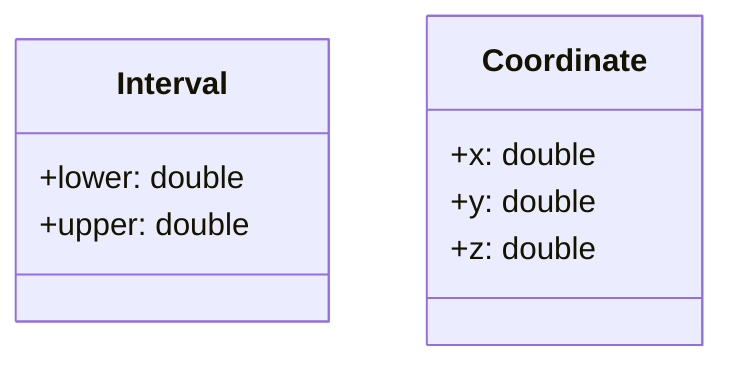

# L'abstraction

> 🤖 Rédaction assistée par IA.

## Définition

L'**abstraction** consiste à **nommer les concepts** manipulés par un programme et à les représenter par des **types** regroupant leurs données. Le code peut alors raisonner sur le concept (un intervalle, une coordonnée...) plutôt que sur ses détails (deux nombres).

En programmation orientée objet, ces types sont définis à l'aide de **classes** :

* Une **classe** décrit un concept à l'aide d'**attributs** (ses données) et de **méthodes** (ses traitements).
* Un **objet** est une **instance** de cette classe (ex : l'intervalle `[0, 2]`).

## Cas d'école

Considérons une fonction qui teste si deux intervalles s'intersectent :

```c
bool intersects(double x1, double y1, double x2, double y2) {
    // ...
}
```

À la lecture de cette signature, il est difficile de savoir **ce que représentent** `x1`, `y1`, `x2` et `y2`, et rien n'empêche l'appelant de **mélanger l'ordre des paramètres**.

De même, considérons un utilitaire qui convertit une coordonnée en chaîne de caractères sous la forme `"[x,y]"` :

```c
string to_json(double x, double y) {
    // ...
}
```

Si nous ajoutons un `z` optionnel pour gérer la 3D, **tous les appels** `to_json(x, y)` **devront être modifiés**.

## Solution

**Définir un type pour chaque concept** permet de le nommer et de regrouper ses données :



La fonction `intersects` manipule alors des intervalles :

=== "TypeScript"

    ```ts
    class Interval {
        lower: number = 0.0;
        upper: number = 0.0;
    }

    function intersects(a: Interval, b: Interval): boolean {
        return a.lower <= b.upper && b.lower <= a.upper;
    }

    const a = new Interval();
    a.lower = 0.0;
    a.upper = 2.0;
    const b = new Interval();
    b.lower = 1.0;
    b.upper = 3.0;
    console.log(intersects(a, b)); // true
    ```

=== "Java"

    ```java
    class Interval {
        public double lower;
        public double upper;
    }

    static boolean intersects(Interval a, Interval b) {
        return a.lower <= b.upper && b.lower <= a.upper;
    }

    Interval a = new Interval();
    a.lower = 0.0;
    a.upper = 2.0;
    Interval b = new Interval();
    b.lower = 1.0;
    b.upper = 3.0;
    System.out.println(intersects(a, b)); // true
    ```

=== "Python"

    ```python
    class Interval:
        lower: float = 0.0
        upper: float = 0.0


    def intersects(a: Interval, b: Interval) -> bool:
        return a.lower <= b.upper and b.lower <= a.upper


    a = Interval()
    a.lower = 0.0
    a.upper = 2.0
    b = Interval()
    b.lower = 1.0
    b.upper = 3.0
    print(intersects(a, b))  # True
    ```

=== "C++"

    ```cpp
    class Interval {
    public:
        double lower = 0.0;
        double upper = 0.0;
    };

    bool intersects(const Interval& a, const Interval& b) {
        return a.lower <= b.upper && b.lower <= a.upper;
    }

    Interval a;
    a.lower = 0.0;
    a.upper = 2.0;
    Interval b;
    b.lower = 1.0;
    b.upper = 3.0;
    std::cout << std::boolalpha << intersects(a, b) << std::endl; // true
    ```

=== "PHP"

    ```php
    <?php

    class Interval
    {
        public float $lower = 0.0;
        public float $upper = 0.0;
    }

    function intersects(Interval $a, Interval $b): bool
    {
        return $a->lower <= $b->upper && $b->lower <= $a->upper;
    }

    $a = new Interval();
    $a->lower = 0.0;
    $a->upper = 2.0;
    $b = new Interval();
    $b->lower = 1.0;
    $b->upper = 3.0;
    var_dump(intersects($a, $b)); // bool(true)
    ```

De même, avec un type `Coordinate`, la signature devient `to_json(Coordinate coordinate)` : l'ajout d'un attribut `z` modifie le type et l'implémentation de `to_json`, mais **les appels restent inchangés**.

## Variantes

### Méthodes

Le traitement peut être associé au concept sous la forme d'une **méthode** de la classe. L'appel devient alors `a.intersects(b)` :

```ts
class Interval {
    lower: number = 0.0;
    upper: number = 0.0;

    intersects(other: Interval): boolean {
        return this.lower <= other.upper && other.lower <= this.upper;
    }
}
```

### Structures

Les langages sans classes permettent déjà cette abstraction à l'aide de **structures** (ex : `struct` en C, voir [Les types - Les structures](../base/types.md#les-structures)). La classe ira plus loin en associant aux données des méthodes, des [constructeurs](index.md) et des mécanismes d'[encapsulation](encapsulation.md).

## Mises en garde

* Dans les exemples ci-dessus, **rien ne garantit qu'un intervalle est valide** (`lower <= upper`) ni que tous ses attributs sont initialisés : ce sera le rôle des **constructeurs** et de l'[encapsulation](encapsulation.md).
* Il est question de **nommer les concepts du domaine**, pas de créer une classe pour chaque donnée manipulée : des classes `Lower` et `Upper` pour les bornes d'un intervalle n'apporteraient rien, ce sont de simples nombres alors que l'intervalle porte une règle qui lui est propre (`lower <= upper`).

## Liens utiles

* [mborne.github.io/cours-patron-conception - Comprendre la POO](https://mborne.github.io/cours-patron-conception/poo.html)
* [fr.wikipedia.org - Abstraction (informatique)](https://fr.wikipedia.org/wiki/Abstraction_(informatique))
* [fr.wikipedia.org - Classe (informatique)](https://fr.wikipedia.org/wiki/Classe_(informatique))
