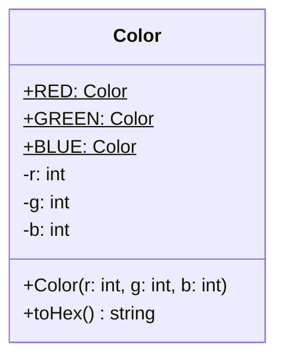

# Les attributs statiques

> 🤖 Rédaction assistée par IA.

## Définition

Un **attribut statique** (ou **attribut de classe**) **appartient à la classe** et non à ses instances :

* Il est **partagé** par toutes les instances de la classe.
* Il est **accessible sans créer d'instance** (ex : `Color.RED`).

## Cas d'école

Considérons une classe `Color` représentant une couleur par ses composantes rouge, verte et bleue. Certaines couleurs sont utilisées dans de nombreuses parties du programme.

Sans attribut statique, nous serons amenés à :

* **Répéter les valeurs** des composantes à chaque utilisation (ex : `new Color(255, 0, 0)` pour le rouge), avec un risque d'erreur et sans pouvoir nommer la couleur.
* Ou définir des **constantes globales** (ex : `const RED = new Color(255, 0, 0)`) qui ne sont pas rattachées au concept de couleur.

## Solution

Le principe consiste à définir les couleurs usuelles sous forme d'**attributs statiques** de la classe `Color` :



=== "TypeScript"

    ```ts
    class Color {
        static readonly RED = new Color(255, 0, 0);
        static readonly GREEN = new Color(0, 255, 0);
        static readonly BLUE = new Color(0, 0, 255);

        constructor(
            readonly r: number,
            readonly g: number,
            readonly b: number,
        ) {}

        toHex(): string {
            return "#" + [this.r, this.g, this.b].map((c) => c.toString(16).padStart(2, "0")).join("");
        }
    }

    console.log(Color.RED.toHex()); // #ff0000
    ```

=== "Java"

    ```java
    class Color {
        public static final Color RED = new Color(255, 0, 0);
        public static final Color GREEN = new Color(0, 255, 0);
        public static final Color BLUE = new Color(0, 0, 255);

        private final int r;
        private final int g;
        private final int b;

        public Color(int r, int g, int b) {
            this.r = r;
            this.g = g;
            this.b = b;
        }

        public String toHex() {
            return String.format("#%02x%02x%02x", r, g, b);
        }
    }

    System.out.println(Color.RED.toHex()); // #ff0000
    ```

=== "Python"

    ```python
    from typing import ClassVar


    class Color:
        RED: ClassVar["Color"]
        GREEN: ClassVar["Color"]
        BLUE: ClassVar["Color"]

        def __init__(self, r: int, g: int, b: int) -> None:
            self.r = r
            self.g = g
            self.b = b

        def to_hex(self) -> str:
            return f"#{self.r:02x}{self.g:02x}{self.b:02x}"


    # la classe doit être définie pour créer ses instances
    Color.RED = Color(255, 0, 0)
    Color.GREEN = Color(0, 255, 0)
    Color.BLUE = Color(0, 0, 255)

    print(Color.RED.to_hex())  # #ff0000
    ```

Les couleurs usuelles sont alors **nommées** et **rattachées au concept** de couleur. Une seule instance de chaque couleur est créée et partagée par tout le programme (`Color.RED === Color.RED`).

## Variantes

### Dans les bibliothèques

En Java, la classe [java.awt.Color](https://docs.oracle.com/en/java/javase/21/docs/api/java.desktop/java/awt/Color.html) fournit ainsi les attributs statiques `Color.RED`, `Color.GREEN`, `Color.BLUE`...

### Énumérations portant des valeurs

Lorsque la liste des valeurs est **fermée**, une [énumération](../base/types.md#les-enumerations) pourra jouer ce rôle. En Java, une énumération peut porter des attributs et des méthodes :

```java
enum Color {
    RED(255, 0, 0), GREEN(0, 255, 0), BLUE(0, 0, 255);

    private final int r;
    private final int g;
    private final int b;

    Color(int r, int g, int b) {
        this.r = r;
        this.g = g;
        this.b = b;
    }

    public String toHex() {
        return String.format("#%02x%02x%02x", r, g, b);
    }
}
```

Avec une énumération, il ne sera toutefois plus possible de créer d'autres couleurs (ex : `new Color(128, 128, 128)`).

### Attributs statiques modifiables

Un attribut statique peut aussi porter un **état partagé** par toutes les instances, par exemple pour compter les instances créées :

```ts
class Counter {
    static count = 0;

    constructor() {
        Counter.count++;
    }
}

new Counter();
new Counter();
console.log(Counter.count); // 2
```

## Mises en garde

* Un attribut statique **modifiable** présente les **mêmes problèmes qu'une variable globale** : état partagé entre les tests, dépendance cachée, accès concurrents... (voir [Singleton](../../architecture/patrons-conception/creation/Singleton.md)).
* Les attributs statiques seront donc plutôt réservés aux **constantes**. Dans ce cas, les instances partagées doivent être **immuables** : si `Color.RED` était modifiable, une modification affecterait tout le programme (voir [Les variables immuables](../base/variable-immuable.md)).
* L'**initialisation est délicate** avec certains langages tels C++ et PHP :
    * En C++, l'attribut statique est **déclaré dans la classe** mais doit être **défini après celle-ci**, le type `Color` n'étant pas complet à l'intérieur de sa propre définition.
    * En PHP, une **constante de classe ne peut pas contenir un objet** : il faudra utiliser un attribut statique initialisé après la classe, qui ne pourra pas être déclaré `readonly`.

    === "C++"

        ```cpp
        class Color {
        public:
            static const Color RED;
            static const Color GREEN;
            static const Color BLUE;

            constexpr Color(int r, int g, int b) : r(r), g(g), b(b) {}

            std::string toHex() const {
                char buffer[8];
                std::snprintf(buffer, sizeof(buffer), "#%02x%02x%02x", r, g, b);
                return buffer;
            }

        private:
            int r;
            int g;
            int b;
        };

        // définition après la classe (le type doit être complet)
        inline const Color Color::RED{255, 0, 0};
        inline const Color Color::GREEN{0, 255, 0};
        inline const Color Color::BLUE{0, 0, 255};

        std::cout << Color::RED.toHex() << std::endl; // #ff0000
        ```

    === "PHP"

        ```php
        class Color
        {
            public static Color $RED;
            public static Color $GREEN;
            public static Color $BLUE;

            public function __construct(
                public readonly int $r,
                public readonly int $g,
                public readonly int $b,
            ) {
            }

            public function toHex(): string
            {
                return sprintf('#%02x%02x%02x', $this->r, $this->g, $this->b);
            }
        }

        // une constante de classe ne peut pas contenir un objet : initialisation après la classe
        Color::$RED = new Color(255, 0, 0);
        Color::$GREEN = new Color(0, 255, 0);
        Color::$BLUE = new Color(0, 0, 255);

        echo Color::$RED->toHex(), "\n"; // #ff0000
        ```

## Liens utiles

* [en.wikipedia.org - Class variable](https://en.wikipedia.org/wiki/Class_variable)
* [developer.mozilla.org - static](https://developer.mozilla.org/fr/docs/Web/JavaScript/Reference/Classes/static)
* [docs.python.org - typing.ClassVar](https://docs.python.org/3/library/typing.html#typing.ClassVar)
* [www.php.net - Le mot-clé static](https://www.php.net/manual/fr/language.oop5.static.php)
