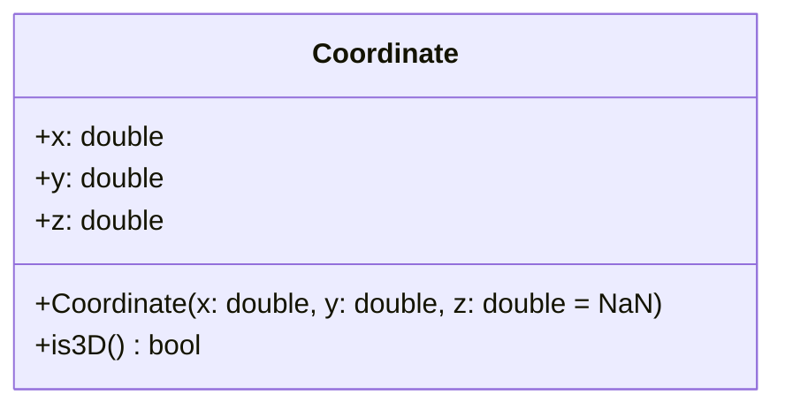

# Les constructeurs

> 🤖 Rédaction assistée par IA.

## Définition

Un **constructeur** est une méthode particulière **appelée lors de la création d'un objet** pour **initialiser ses attributs**. Il permet de **sécuriser l'initialisation** : un objet est complet et valide dès sa création.

## Cas d'école

Reprenons le type `Coordinate` de la fiche [L'abstraction](abstraction.md). Sans constructeur, l'initialisation est à la charge de l'appelant :

```c
Coordinate c;
c.x = 3.0;
c.y = 4.0;
```

Avec cette approche :

* Rien n'empêche d'**oublier l'affectation d'un attribut** (ex : `c.y`).
* L'**ajout d'un attribut optionnel** (ex : un `z` défini à `NaN` en 2D) impose de modifier toutes les initialisations.

Il est bien sûr possible de définir une fonction utilitaire :

```c
Coordinate create_coordinate(double x, double y) {
    Coordinate c;
    c.x = x;
    c.y = y;
    return c;
}
```

...mais **rien n'oblige à l'utiliser**.

## Solution

Le **concept de constructeur impose l'utilisation de cette fonction d'initialisation** aux utilisateurs du type `Coordinate` :



=== "TypeScript"

    ```ts
    class Coordinate {
        x: number;
        y: number;
        z: number;

        constructor(x: number, y: number, z: number = NaN) {
            this.x = x;
            this.y = y;
            this.z = z;
        }

        is3D(): boolean {
            return !Number.isNaN(this.z);
        }
    }

    const c2 = new Coordinate(3.0, 4.0); // z vaut NaN
    const c3 = new Coordinate(3.0, 4.0, 5.0);
    ```

=== "Java"

    ```java
    class Coordinate {
        public double x;
        public double y;
        public double z;

        public Coordinate(double x, double y, double z) {
            this.x = x;
            this.y = y;
            this.z = z;
        }

        public Coordinate(double x, double y) {
            this(x, y, Double.NaN);
        }

        public boolean is3D() {
            return !Double.isNaN(z);
        }
    }

    Coordinate c2 = new Coordinate(3.0, 4.0); // z vaut NaN
    Coordinate c3 = new Coordinate(3.0, 4.0, 5.0);
    ```

=== "Python"

    ```python
    import math


    class Coordinate:
        def __init__(self, x: float, y: float, z: float = math.nan) -> None:
            self.x = x
            self.y = y
            self.z = z

        def is_3d(self) -> bool:
            return not math.isnan(self.z)


    c2 = Coordinate(3.0, 4.0)  # z vaut NaN
    c3 = Coordinate(3.0, 4.0, 5.0)
    ```

=== "C++"

    ```cpp
    class Coordinate {
    public:
        double x;
        double y;
        double z;

        Coordinate(double x, double y, double z = std::numeric_limits<double>::quiet_NaN())
            : x(x), y(y), z(z) {}

        bool is3D() const {
            return !std::isnan(z);
        }
    };

    Coordinate c2(3.0, 4.0); // z vaut NaN
    Coordinate c3(3.0, 4.0, 5.0);
    // Coordinate c; // erreur de compilation : pas de constructeur sans paramètre
    ```

=== "PHP"

    ```php
    class Coordinate
    {
        public float $x;
        public float $y;
        public float $z;

        public function __construct(float $x, float $y, float $z = NAN)
        {
            $this->x = $x;
            $this->y = $y;
            $this->z = $z;
        }

        public function is3D(): bool
        {
            return !is_nan($this->z);
        }
    }

    $c2 = new Coordinate(3.0, 4.0); // z vaut NaN
    $c3 = new Coordinate(3.0, 4.0, 5.0);
    ```

Il n'est plus possible de créer une coordonnée sans `x` ni `y`, et l'ajout de `z` n'a pas modifié les appels existants `new Coordinate(3.0, 4.0)`.

## Variantes

### Validation des paramètres

Le constructeur est le bon endroit pour **refuser la création d'un objet invalide**. Par exemple, pour garantir `lower <= upper` sur l'`Interval` de la fiche [L'abstraction](abstraction.md) :

```ts
class Interval {
    lower: number;
    upper: number;

    constructor(lower: number, upper: number) {
        if (lower > upper) {
            throw new Error(`intervalle invalide : [${lower}, ${upper}]`);
        }
        this.lower = lower;
        this.upper = upper;
    }
}
```

Pour que cette garantie tienne après la création, il faudra aussi empêcher la modification directe des attributs (voir [L'encapsulation](encapsulation.md)).

### Surcharge ou valeurs par défaut

Pour rendre un paramètre optionnel :

* Java et C++ permettent de définir **plusieurs constructeurs** (surcharge), l'un pouvant appeler l'autre (ex : `this(x, y, Double.NaN)` en Java).
* TypeScript, Python, PHP et C++ permettent de définir des **valeurs par défaut** pour les paramètres.

### Promotion des paramètres

TypeScript (*parameter properties*) et PHP >= 8.0 (promotion des propriétés) permettent de **déclarer et initialiser les attributs directement dans la signature** du constructeur :

=== "TypeScript"

    ```ts
    class Coordinate {
        constructor(
            public x: number,
            public y: number,
            public z: number = NaN,
        ) {}
    }

    const c2 = new Coordinate(3.0, 4.0); // z vaut NaN
    ```

=== "PHP"

    ```php
    class Coordinate
    {
        public function __construct(
            public float $x,
            public float $y,
            public float $z = NAN,
        ) {
        }
    }

    $c2 = new Coordinate(3.0, 4.0); // z vaut NaN
    ```

En Python, le décorateur `@dataclass` génère quant à lui la méthode `__init__` à partir des attributs déclarés :

```python
import math
from dataclasses import dataclass


@dataclass
class Coordinate:
    x: float
    y: float
    z: float = math.nan


c2 = Coordinate(3.0, 4.0)  # z vaut NaN
print(c2)  # Coordinate(x=3.0, y=4.0, z=nan)
```

## Mises en garde

* Un constructeur doit se limiter à **initialiser l'objet** : y ouvrir une connexion ou lire un fichier rend la classe difficile à tester. Il sera préférable de lui **fournir ses dépendances** (voir [L'injection de dépendances](../../architecture/patrons-conception/architecturaux/InjectionDependances.md)).
* Un constructeur ne doit pas **déclencher de traitement asynchrone** (ex : une `Promise` en JavaScript / TypeScript) : il ne peut pas attendre sa fin (`async constructor` est interdit), l'objet est renvoyé avant d'être complètement initialisé et les erreurs éventuelles ne sont pas remontées à l'appelant.

    ??? info "Il sera préférable de réaliser le traitement asynchrone dans une méthode de fabrique statique"

        ```ts
        class Database {
            private constructor(private config: string) {}

            static async create(path: string): Promise<Database> {
                const config = await loadConfig(path); // traitement asynchrone
                return new Database(config);
            }
        }

        const db = await Database.create("config.json");
        ```

* Un constructeur ayant **de nombreux paramètres** devient difficile à utiliser (ordre des paramètres, paramètres optionnels...). Les patrons [Factory](../../architecture/patrons-conception/creation/Factory.md) et [Builder](../../architecture/patrons-conception/creation/Builder.md) pourront alors simplifier la création des objets.

## Liens utiles

* [mborne.github.io/cours-patron-conception - Comprendre la POO](https://mborne.github.io/cours-patron-conception/poo.html)
* [fr.wikipedia.org - Constructeur (programmation)](https://fr.wikipedia.org/wiki/Constructeur_(programmation))
* [www.typescriptlang.org - Parameter Properties](https://www.typescriptlang.org/docs/handbook/2/classes.html#parameter-properties)
* [www.php.net - Promotion des propriétés du constructeur](https://www.php.net/manual/fr/language.oop5.decon.php#language.oop5.decon.constructor.promotion)
