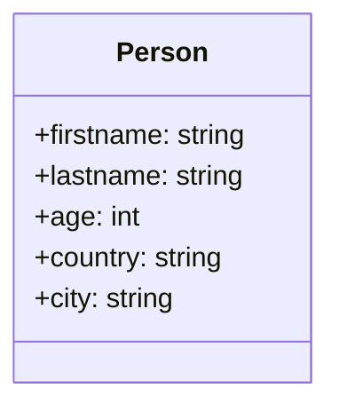
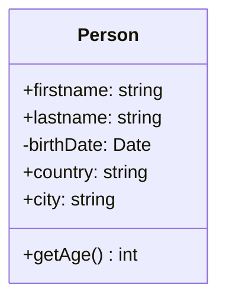

# L'encapsulation

> 🤖 Rédaction assistée par IA.

L'**encapsulation** consiste à **regrouper les données et les traitements** qui les manipulent au sein d'une classe et à **masquer les détails de l'implémentation** derrière une interface publique. Elle s'appuie sur :

* La **visibilité** des membres (`public`, `protected`, `private`)
* Les **accesseurs** (`getX()`, `setX(...)`, `addX(...)`, `removeX(...)`...) qui permettent un **accès indirect** aux données

## Cas d'école

Avec une classe `Person` dont les attributs sont publics, nous pouvons nous demander **à quoi bon définir des attributs privés** :



Après tout, il est plus simple d'écrire `person.age` plutôt que `person.getAge()`.

Pour comprendre l'intérêt de l'encapsulation, imaginons que nous stockons des personnes ainsi modélisées... et que nous laissons passer un an. **Les âges stockés sont tous faux !**

Nous souhaitons alors **changer la modélisation** pour stocker la **date de naissance** (invariant temporel) et **calculer l'âge** à partir de celle-ci :



L'attribut `age` étant public, **tout le code client** utilisant `person.age` (ex : `if (person.age >= 18)`) **devra être modifié** : nous sommes face à un **changement cassant**.

## Solution

**Permettre l'accès aux données uniquement via une indirection** (ex : `person.getAge()`), c'est **se donner la possibilité de modifier une classe sans casser le code client**.

Si `Person` avait exposé une méthode `getAge()` dès le départ, il suffirait de modifier son implémentation : le code client `person.getAge() >= 18` fonctionnerait **avant et après** le changement de modélisation.

Par exemple :

=== "TypeScript"

    ```ts
    class Person {
        constructor(
            private firstname: string,
            private lastname: string,
            private birthDate: Date,
        ) {}

        getFirstname(): string {
            return this.firstname;
        }

        getLastname(): string {
            return this.lastname;
        }

        getAge(): number {
            const today = new Date();
            let age = today.getFullYear() - this.birthDate.getFullYear();
            const beforeBirthday =
                today.getMonth() < this.birthDate.getMonth() ||
                (today.getMonth() === this.birthDate.getMonth() && today.getDate() < this.birthDate.getDate());
            if (beforeBirthday) {
                age--;
            }
            return age;
        }
    }
    ```

=== "Java"

    ```java
    import java.time.LocalDate;
    import java.time.Period;

    public class Person {
        private String firstname;
        private String lastname;
        private LocalDate birthDate;

        public Person(String firstname, String lastname, LocalDate birthDate) {
            this.firstname = firstname;
            this.lastname = lastname;
            this.birthDate = birthDate;
        }

        public String getFirstname() {
            return firstname;
        }

        public String getLastname() {
            return lastname;
        }

        public int getAge() {
            return Period.between(birthDate, LocalDate.now()).getYears();
        }
    }
    ```

=== "C++"

    ```cpp
    #include <chrono>
    #include <string>
    #include <utility>

    class Person {
    public:
        Person(std::string firstname, std::string lastname, std::chrono::year_month_day birthDate)
            : _firstname(std::move(firstname)), _lastname(std::move(lastname)), _birthDate(birthDate) {}

        const std::string& getFirstname() const { return _firstname; }
        const std::string& getLastname() const { return _lastname; }

        int getAge() const {
            using namespace std::chrono;
            const year_month_day today{floor<days>(system_clock::now())};
            int age = int(today.year()) - int(_birthDate.year());
            if (today.month() < _birthDate.month() ||
                (today.month() == _birthDate.month() && today.day() < _birthDate.day())) {
                --age;
            }
            return age;
        }

    private:
        std::string _firstname;
        std::string _lastname;
        std::chrono::year_month_day _birthDate;
    };
    ```

=== "PHP"

    ```php
    <?php

    class Person
    {
        public function __construct(
            private string $firstname,
            private string $lastname,
            private DateTimeImmutable $birthDate,
        ) {
        }

        public function getFirstname(): string
        {
            return $this->firstname;
        }

        public function getLastname(): string
        {
            return $this->lastname;
        }

        public function getAge(): int
        {
            return $this->birthDate->diff(new DateTimeImmutable())->y;
        }
    }
    ```

## Variantes

### Visibilité

Les mécanismes de visibilité varient d'un langage à l'autre :

| Langage | Visibilité disponible | Par défaut | Particularités |
| ------- | --------------------- | ---------- | -------------- |
| TypeScript | `public`, `protected`, `private` | `public` | `private` est vérifié **uniquement à la compilation** (contrairement à `#attribut` en JavaScript) |
| Java | `public`, `protected`, `private` | *package-private* | `protected` donne aussi accès au package |
| Python | Aucune (conventions) | public | `_attribut` signale un membre interne, `__attribut` déclenche un *name mangling* |
| C++ | `public`, `protected`, `private` | `private` (`class`), `public` (`struct`) | `friend` permet d'ouvrir l'accès à une classe ou fonction |
| PHP | `public`, `protected`, `private` | `public` | `readonly` (PHP >= 8.1) pour un attribut non modifiable après initialisation |

### Propriétés

Certains langages permettent d'**exécuter du code lors de l'accès à un attribut** : un attribut public peut alors être transformé en propriété calculée **sans modifier le code client** :

* [`get` / `set`](https://developer.mozilla.org/fr/docs/Web/JavaScript/Reference/Functions/get) en JavaScript et TypeScript (ex : `get age(): number { ... }`)
* [`@property`](https://docs.python.org/3/library/functions.html#property) en Python
* [Les propriétés](https://learn.microsoft.com/fr-fr/dotnet/csharp/programming-guide/classes-and-structs/properties) en C#
* [Les *property hooks*](https://www.php.net/manual/fr/language.oop5.property-hooks.php) en PHP >= 8.4

Avec ces langages, il est donc **possible de se passer de *getters* introduits par précaution** (sous réserve de disposer du mécanisme, ex : PHP >= 8.4 pour les *property hooks*) : un attribut public pourra être transformé en propriété le jour où le besoin se présentera.

Par exemple, en Python, la première version de `Person` pourra se contenter d'un attribut public :

```python
class Person:
    def __init__(self, firstname: str, lastname: str, age: int):
        self.firstname = firstname
        self.lastname = lastname
        self.age = age
```

Lors du passage à la date de naissance, le décorateur `@property` permettra de calculer `age` **sans modifier le code client** (`person.age >= 18`) :

```python
from datetime import date


class Person:
    def __init__(self, firstname: str, lastname: str, birth_date: date):
        self.firstname = firstname
        self.lastname = lastname
        self._birth_date = birth_date

    @property
    def age(self) -> int:
        today = date.today()
        before_birthday = (today.month, today.day) < (self._birth_date.month, self._birth_date.day)
        return today.year - self._birth_date.year - int(before_birthday)
```

### Encapsulation au niveau du module

L'encapsulation peut prendre d'autres formes que la visibilité des membres d'une classe. Par exemple, en TypeScript, une fonction ou une classe non exportée (`export`) n'est pas accessible en dehors de son module.

## Mises en garde

* **Il ne suffit pas d'ajouter mécaniquement des *getters* et des *setters* sur tous les attributs** : il est plutôt question d'**exposer uniquement ce qui doit l'être**. En limitant la surface d'exposition, nous limitons le risque de changement cassant.
* Il reste un point discutable dans la modélisation de la classe `Person`... Vous l'avez ?

## Liens utiles

* [mborne.github.io/cours-patron-conception - Comprendre la POO](https://mborne.github.io/cours-patron-conception/poo.html)
* [fr.wikipedia.org - Encapsulation (programmation)](https://fr.wikipedia.org/wiki/Encapsulation_(programmation))
* [refactoring.guru - Encapsulate Field](https://refactoring.guru/encapsulate-field)
