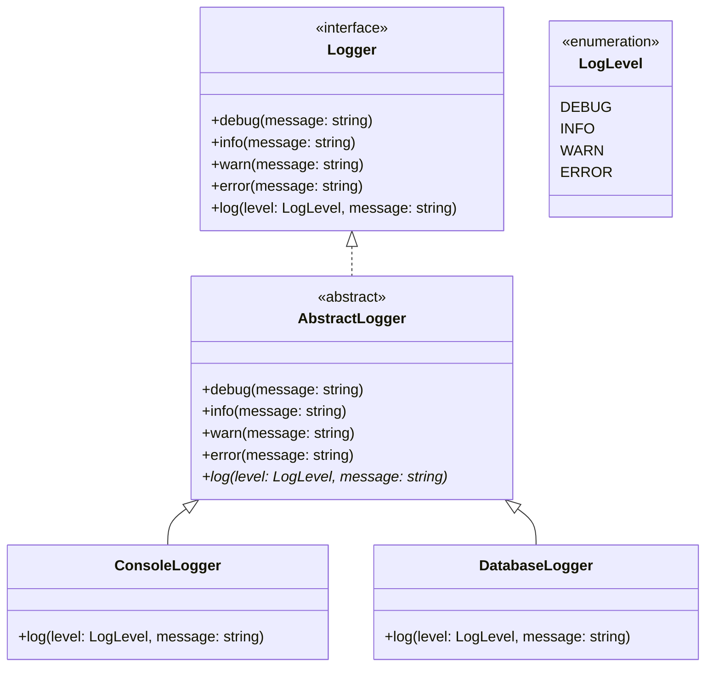

# L'héritage à trois niveaux

> 🤖 Rédaction assistée par IA.

## Définition

L'**héritage à trois niveaux** combine une [interface](interface.md), une **classe abstraite** et des **classes concrètes** :

* L'**interface** définit le **contrat** dont dépend le code client.
* La **classe abstraite** implémente l'interface et **met en facteur l'implémentation commune** à plusieurs classes concrètes. Certaines de ses méthodes sont déclarées sans être implémentées (**méthodes abstraites**).
* Les **classes concrètes** héritent de la classe abstraite et implémentent uniquement ce qui leur est **spécifique**.

## Cas d'école

Considérons une interface `Logger` permettant d'écrire des messages de différents niveaux (`debug`, `info`, `warn`, `error`) et deux implémentations : `ConsoleLogger` (affichage dans la console) et `DatabaseLogger` (stockage en base de données).

Si chaque implémentation réalise directement l'interface, les méthodes `debug`, `info`, `warn` et `error` seront **dupliquées** dans chacune d'elles alors qu'elles se contentent d'appeler `log` avec le niveau correspondant :

```ts
class ConsoleLogger implements Logger {
    debug(message: string): void {
        this.log(LogLevel.DEBUG, message);
    }

    info(message: string): void {
        this.log(LogLevel.INFO, message);
    }

    // ... warn, error

    log(level: LogLevel, message: string): void {
        console.log(`[${level}] ${message}`);
    }
}

class DatabaseLogger implements Logger {
    // ... debug, info, warn et error à l'identique

    log(level: LogLevel, message: string): void {
        // insertion en base de données
    }
}
```

## Solution

Le principe consiste à introduire une classe abstraite `AbstractLogger` qui implémente `debug`, `info`, `warn` et `error` en s'appuyant sur la méthode abstraite `log` :



=== "TypeScript"

    ```ts
    enum LogLevel {
        DEBUG = "DEBUG",
        INFO = "INFO",
        WARN = "WARN",
        ERROR = "ERROR",
    }

    interface Logger {
        debug(message: string): void;
        info(message: string): void;
        warn(message: string): void;
        error(message: string): void;
        log(level: LogLevel, message: string): void;
    }

    abstract class AbstractLogger implements Logger {
        debug(message: string): void {
            this.log(LogLevel.DEBUG, message);
        }

        info(message: string): void {
            this.log(LogLevel.INFO, message);
        }

        warn(message: string): void {
            this.log(LogLevel.WARN, message);
        }

        error(message: string): void {
            this.log(LogLevel.ERROR, message);
        }

        abstract log(level: LogLevel, message: string): void;
    }

    class ConsoleLogger extends AbstractLogger {
        log(level: LogLevel, message: string): void {
            console.log(`[${level}] ${message}`);
        }
    }

    const logger: Logger = new ConsoleLogger();
    logger.info("démarrage"); // [INFO] démarrage
    ```

=== "Java"

    ```java
    enum LogLevel { DEBUG, INFO, WARN, ERROR }

    interface Logger {
        void debug(String message);
        void info(String message);
        void warn(String message);
        void error(String message);
        void log(LogLevel level, String message);
    }

    abstract class AbstractLogger implements Logger {
        @Override
        public void debug(String message) {
            log(LogLevel.DEBUG, message);
        }

        @Override
        public void info(String message) {
            log(LogLevel.INFO, message);
        }

        @Override
        public void warn(String message) {
            log(LogLevel.WARN, message);
        }

        @Override
        public void error(String message) {
            log(LogLevel.ERROR, message);
        }
    }

    class ConsoleLogger extends AbstractLogger {
        @Override
        public void log(LogLevel level, String message) {
            System.out.println("[" + level + "] " + message);
        }
    }

    Logger logger = new ConsoleLogger();
    logger.info("démarrage"); // [INFO] démarrage
    ```

=== "Python"

    ```python
    from abc import ABC, abstractmethod
    from enum import Enum
    from typing import Protocol


    class LogLevel(Enum):
        DEBUG = "DEBUG"
        INFO = "INFO"
        WARN = "WARN"
        ERROR = "ERROR"


    class Logger(Protocol):
        def debug(self, message: str) -> None: ...
        def info(self, message: str) -> None: ...
        def warn(self, message: str) -> None: ...
        def error(self, message: str) -> None: ...
        def log(self, level: LogLevel, message: str) -> None: ...


    class AbstractLogger(ABC):
        def debug(self, message: str) -> None:
            self.log(LogLevel.DEBUG, message)

        def info(self, message: str) -> None:
            self.log(LogLevel.INFO, message)

        def warn(self, message: str) -> None:
            self.log(LogLevel.WARN, message)

        def error(self, message: str) -> None:
            self.log(LogLevel.ERROR, message)

        @abstractmethod
        def log(self, level: LogLevel, message: str) -> None: ...


    class ConsoleLogger(AbstractLogger):
        def log(self, level: LogLevel, message: str) -> None:
            print(f"[{level.value}] {message}")


    logger: Logger = ConsoleLogger()
    logger.info("démarrage")  # [INFO] démarrage
    ```

=== "C++"

    ```cpp
    enum class LogLevel { Debug, Info, Warn, Error };

    std::string toString(LogLevel level) {
        switch (level) {
        case LogLevel::Debug: return "DEBUG";
        case LogLevel::Info: return "INFO";
        case LogLevel::Warn: return "WARN";
        case LogLevel::Error: return "ERROR";
        }
        return "";
    }

    class Logger {
    public:
        virtual ~Logger() = default;
        virtual void debug(const std::string& message) = 0;
        virtual void info(const std::string& message) = 0;
        virtual void warn(const std::string& message) = 0;
        virtual void error(const std::string& message) = 0;
        virtual void log(LogLevel level, const std::string& message) = 0;
    };

    class AbstractLogger : public Logger {
    public:
        void debug(const std::string& message) override { log(LogLevel::Debug, message); }
        void info(const std::string& message) override { log(LogLevel::Info, message); }
        void warn(const std::string& message) override { log(LogLevel::Warn, message); }
        void error(const std::string& message) override { log(LogLevel::Error, message); }
    };

    class ConsoleLogger : public AbstractLogger {
    public:
        void log(LogLevel level, const std::string& message) override {
            std::cout << "[" << toString(level) << "] " << message << std::endl;
        }
    };

    std::unique_ptr<Logger> logger = std::make_unique<ConsoleLogger>();
    logger->info("démarrage"); // [INFO] démarrage
    ```

=== "PHP"

    ```php
    enum LogLevel: string
    {
        case Debug = 'DEBUG';
        case Info = 'INFO';
        case Warn = 'WARN';
        case Error = 'ERROR';
    }

    interface Logger
    {
        public function debug(string $message): void;
        public function info(string $message): void;
        public function warn(string $message): void;
        public function error(string $message): void;
        public function log(LogLevel $level, string $message): void;
    }

    abstract class AbstractLogger implements Logger
    {
        public function debug(string $message): void
        {
            $this->log(LogLevel::Debug, $message);
        }

        public function info(string $message): void
        {
            $this->log(LogLevel::Info, $message);
        }

        public function warn(string $message): void
        {
            $this->log(LogLevel::Warn, $message);
        }

        public function error(string $message): void
        {
            $this->log(LogLevel::Error, $message);
        }
    }

    class ConsoleLogger extends AbstractLogger
    {
        public function log(LogLevel $level, string $message): void
        {
            echo "[{$level->value}] {$message}\n";
        }
    }

    $logger = new ConsoleLogger();
    $logger->info('démarrage'); // [INFO] démarrage
    ```

L'ajout d'un `DatabaseLogger` se limite alors à l'implémentation de la méthode `log`.

## Variantes

### Dans les bibliothèques

Ce modèle se retrouve dans de nombreuses bibliothèques :

* En PHP, la norme [PSR-3](https://www.php-fig.org/psr/psr-3/) définit l'interface `LoggerInterface` et le paquet `psr/log` fournit une classe [AbstractLogger](https://github.com/php-fig/log/blob/master/src/AbstractLogger.php) dont les implémentations n'ont plus qu'à fournir la méthode `log`.
* En Java, l'interface `List` est implémentée par la classe abstraite [AbstractList](https://docs.oracle.com/en/java/javase/21/docs/api/java.base/java/util/AbstractList.html) dont hérite `ArrayList`.

### Patron Template Method

Les méthodes `debug`, `info`, `warn` et `error` de la classe abstraite s'appuient sur une méthode `log` implémentée par les classes concrètes : il s'agit d'une application du patron [Template Method](../../architecture/patrons-conception/comportement/TemplateMethod.md).

## Mises en garde

* Le code client doit **dépendre de l'interface** (`Logger`) et **non de la classe abstraite** (`AbstractLogger`) : la classe abstraite n'est qu'une **facilité pour l'implémentation**.
* Une classe concrète doit rester libre d'**implémenter directement l'interface** si la classe abstraite ne lui convient pas.
* Il n'est pas question de **multiplier les niveaux d'héritage** (voir [L'héritage et le polymorphisme - Mises en garde](polymorphisme.md#mises-en-garde)).

## Liens utiles

* [mborne.github.io/cours-patron-conception - Comprendre la POO](https://mborne.github.io/cours-patron-conception/poo.html)
* [www.php-fig.org - PSR-3: Logger Interface](https://www.php-fig.org/psr/psr-3/)
