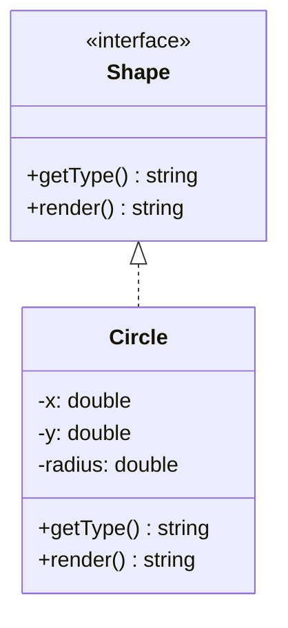

# Les interfaces

> 🤖 Rédaction assistée par IA.

## Définition

Une **interface** définit un **contrat** : la liste des méthodes qu'une classe s'engage à fournir, **sans leur implémentation**. Une classe qui **implémente** l'interface doit fournir l'implémentation de chacune de ces méthodes.

Le code client peut alors **dépendre du contrat plutôt que d'une implémentation** (ex : manipuler une `Shape` sans savoir s'il s'agit d'un `Circle` ou d'un `Rectangle`).

## Cas d'école

Dans la fiche [L'héritage et le polymorphisme](polymorphisme.md), la classe de base `Shape` ne contient **aucune implémentation** : elle se contente de déclarer les méthodes attendues. Dans les langages le permettant, elle peut se distinguer d'une classe de base à l'aide d'un mot clé dédié.

## Solution

Le **concept d'interface** permet de **définir le contrat qui sera respecté par les classes** qui l'implémentent :



=== "TypeScript"

    ```ts
    interface Shape {
        getType(): string;
        render(): string;
    }

    class Circle implements Shape {
        constructor(private x: number, private y: number, private radius: number) {}

        getType(): string {
            return "Circle";
        }

        render(): string {
            return `<circle cx="${this.x}" cy="${this.y}" r="${this.radius}" />`;
        }
    }

    function renderAll(shapes: Shape[]): string {
        return shapes.map((shape) => shape.render()).join("\n");
    }
    ```

=== "Java"

    ```java
    interface Shape {
        String getType();
        String render();
    }

    class Circle implements Shape {
        private double x;
        private double y;
        private double radius;

        public Circle(double x, double y, double radius) {
            this.x = x;
            this.y = y;
            this.radius = radius;
        }

        @Override
        public String getType() {
            return "Circle";
        }

        @Override
        public String render() {
            return String.format("<circle cx=\"%s\" cy=\"%s\" r=\"%s\" />", x, y, radius);
        }
    }

    static String renderAll(List<Shape> shapes) {
        StringBuilder sb = new StringBuilder();
        for (Shape shape : shapes) {
            sb.append(shape.render()).append("\n");
        }
        return sb.toString();
    }
    ```

=== "C++"

    ```cpp
    // C++ ne dispose pas de mot clé interface :
    // une classe ne contenant que des méthodes virtuelles pures joue ce rôle
    class Shape {
    public:
        virtual ~Shape() = default;
        virtual std::string getType() const = 0;
        virtual std::string render() const = 0;
    };

    class Circle : public Shape {
    public:
        Circle(double x, double y, double radius) : x(x), y(y), radius(radius) {}

        std::string getType() const override {
            return "Circle";
        }

        std::string render() const override {
            std::ostringstream os;
            os << "<circle cx=\"" << x << "\" cy=\"" << y << "\" r=\"" << radius << "\" />";
            return os.str();
        }

    private:
        double x;
        double y;
        double radius;
    };

    std::string renderAll(const std::vector<std::unique_ptr<Shape>>& shapes) {
        std::string result;
        for (const auto& shape : shapes) {
            result += shape->render() + "\n";
        }
        return result;
    }
    ```

=== "PHP"

    ```php
    interface Shape
    {
        public function getType(): string;
        public function render(): string;
    }

    class Circle implements Shape
    {
        public function __construct(
            private float $x,
            private float $y,
            private float $radius,
        ) {
        }

        public function getType(): string
        {
            return 'Circle';
        }

        public function render(): string
        {
            return sprintf('<circle cx="%s" cy="%s" r="%s" />', $this->x, $this->y, $this->radius);
        }
    }

    /** @param Shape[] $shapes */
    function renderAll(array $shapes): string
    {
        return implode("\n", array_map(fn (Shape $shape) => $shape->render(), $shapes));
    }
    ```

La fonction `renderAll` ne dépend que du contrat `Shape` : toute classe implémentant l'interface pourra lui être transmise.

## Variantes

### Implémentation de plusieurs interfaces

Une classe peut **implémenter plusieurs interfaces** alors qu'elle n'hérite que d'une seule classe en Java, en PHP ou en TypeScript. Par exemple, en PHP, `Circle` pourra aussi implémenter l'interface standard [JsonSerializable](https://www.php.net/manual/fr/class.jsonserializable.php) pour contrôler sa conversion en JSON :

```php
class Circle implements Shape, JsonSerializable
{
    // ...

    public function jsonSerialize(): mixed
    {
        return ['type' => $this->getType(), 'x' => $this->x, 'y' => $this->y, 'radius' => $this->radius];
    }
}
```

### Attributs dans une interface

Avec Java ou PHP, une interface permet uniquement de **définir la liste des méthodes**. Avec TypeScript, il sera aussi possible de **spécifier des attributs** :

```ts
interface Shape {
    readonly type: string;
    render(): string;
}
```

### Interfaces implicites

TypeScript s'appuie sur un **typage structurel** : un objet disposant des méthodes attendues respecte l'interface, même sans `implements` :

```ts
const label = {
    getType: () => "Label",
    render: () => "<text>Hello</text>",
};
renderAll([label]); // accepté
```

`Protocol` en Python et les interfaces en Go fonctionnent sur le même principe.

### Alternative au mot clé interface

Python ne dispose pas de mot clé `interface` : `Protocol` (Python >= 3.8) définit un contrat qui sera **vérifié par les outils d'analyse statique** (ex : [mypy](https://mypy.readthedocs.io/)) :

```python
from typing import Protocol


class Shape(Protocol):
    def get_type(self) -> str: ...

    def render(self) -> str: ...


class Circle:  # pas d'héritage : il suffit d'avoir les méthodes attendues
    def __init__(self, x: float, y: float, radius: float) -> None:
        self.x = x
        self.y = y
        self.radius = radius

    def get_type(self) -> str:
        return "Circle"

    def render(self) -> str:
        return f'<circle cx="{self.x}" cy="{self.y}" r="{self.radius}" />'


def render_all(shapes: list[Shape]) -> str:
    return "\n".join(shape.render() for shape in shapes)
```

## Mises en garde

**Il ne suffira pas de définir aveuglément des interfaces** pour avoir de la souplesse sur l'implémentation :

* Concevoir une interface revient à **faire des choix**.
* Ces choix peuvent **impacter les performances**.
* L'implémentation de certaines interfaces est **plus complexe** que d'autres.

Par exemple, en renvoyant un tableau, nous imposerons le **chargement de tous les résultats en mémoire** :

```ts
interface Database {
    query(sql: string, params: unknown[]): Row[];
}
```

Il sera souvent pertinent de **permettre seulement l'itération sur les résultats** pour les données volumineuses (voir le patron [Iterator](../../architecture/patrons-conception/comportement/Iterator.md)) :

```ts
interface Database {
    query(sql: string, params: unknown[]): Iterable<Row>;
}
```

Il faudra donc bien **réfléchir aux implications des choix effectués dans la conception de l'interface**.

## Liens utiles

* [mborne.github.io/cours-patron-conception - Comprendre la POO](https://mborne.github.io/cours-patron-conception/poo.html)
* [fr.wikipedia.org - Interface (programmation orientée objet)](https://fr.wikipedia.org/wiki/Interface_(programmation_orient%C3%A9e_objet))
* [www.typescriptlang.org - Interfaces](https://www.typescriptlang.org/docs/handbook/2/objects.html)
* [docs.python.org - typing.Protocol](https://docs.python.org/3/library/typing.html#typing.Protocol)
