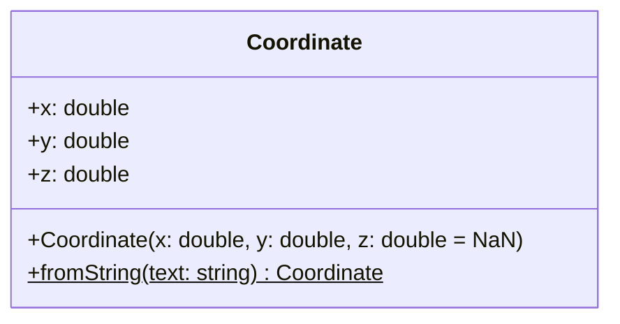

# Les méthodes statiques

> 🤖 Rédaction assistée par IA.

## Définition

Une **méthode statique** (ou **méthode de classe**) **appartient à la classe** et non à ses instances :

* Elle est **appelée sans créer d'instance** (ex : `Coordinate.fromString("3,4")`).
* Elle n'a **pas accès à l'instance courante** (`this` / `self`), mais peut accéder aux [attributs statiques](attribut-statique.md) et créer des instances de la classe.

## Cas d'école

Reprenons la classe `Coordinate` de la fiche [Les constructeurs](constructeur.md). Nous souhaitons créer une coordonnée à partir d'une chaîne de caractères (ex : `"3,4"` ou `"3,4,5"`).

Sans méthode statique, nous serons amenés à :

* Définir une **fonction utilitaire** (ex : `parseCoordinate(text)`) qui n'est pas rattachée au concept de coordonnée.
* Ou **surcharger le constructeur** (ex : `new Coordinate("3,4")`), ce qui n'est pas possible dans tous les langages et rend l'intention moins lisible.

## Solution

Le principe consiste à définir une **méthode de fabrique statique** `fromString` dans la classe `Coordinate` :



=== "TypeScript"

    ```ts
    class Coordinate {
        constructor(
            readonly x: number,
            readonly y: number,
            readonly z: number = NaN,
        ) {}

        static fromString(text: string): Coordinate {
            const values = text.split(",").map(Number);
            if (values.length < 2 || values.length > 3 || values.some(Number.isNaN)) {
                throw new Error(`coordonnée invalide : "${text}"`);
            }
            return new Coordinate(values[0], values[1], values[2] ?? NaN);
        }
    }

    const c = Coordinate.fromString("3,4"); // appel sans instance
    ```

=== "Java"

    ```java
    class Coordinate {
        private final double x;
        private final double y;
        private final double z;

        public Coordinate(double x, double y, double z) {
            this.x = x;
            this.y = y;
            this.z = z;
        }

        public static Coordinate fromString(String text) {
            String[] parts = text.split(",");
            if (parts.length < 2 || parts.length > 3) {
                throw new IllegalArgumentException("coordonnée invalide : \"" + text + "\"");
            }
            double x = Double.parseDouble(parts[0]);
            double y = Double.parseDouble(parts[1]);
            double z = parts.length == 3 ? Double.parseDouble(parts[2]) : Double.NaN;
            return new Coordinate(x, y, z);
        }
    }

    Coordinate c = Coordinate.fromString("3,4"); // appel sans instance
    ```

=== "Python"

    ```python
    import math
    from typing import Self


    class Coordinate:
        def __init__(self, x: float, y: float, z: float = math.nan) -> None:
            self.x = x
            self.y = y
            self.z = z

        @classmethod
        def from_string(cls, text: str) -> Self:
            values = [float(value) for value in text.split(",")]
            if not 2 <= len(values) <= 3:
                raise ValueError(f'coordonnée invalide : "{text}"')
            return cls(*values)


    c = Coordinate.from_string("3,4")  # appel sans instance
    ```

=== "C++"

    ```cpp
    class Coordinate {
    public:
        Coordinate(double x, double y, double z = std::numeric_limits<double>::quiet_NaN())
            : x(x), y(y), z(z) {}

        static Coordinate fromString(const std::string& text) {
            std::vector<double> values;
            std::istringstream stream(text);
            std::string part;
            while (std::getline(stream, part, ',')) {
                values.push_back(std::stod(part));
            }
            if (values.size() < 2 || values.size() > 3) {
                throw std::invalid_argument("coordonnée invalide : \"" + text + "\"");
            }
            return values.size() == 3 ? Coordinate(values[0], values[1], values[2])
                                      : Coordinate(values[0], values[1]);
        }

        double x;
        double y;
        double z;
    };

    Coordinate c = Coordinate::fromString("3,4"); // appel sans instance
    ```

=== "PHP"

    ```php
    class Coordinate
    {
        public function __construct(
            public readonly float $x,
            public readonly float $y,
            public readonly float $z = NAN,
        ) {
        }

        public static function fromString(string $text): static
        {
            $parts = explode(',', $text);
            if (count($parts) < 2 || count($parts) > 3) {
                throw new InvalidArgumentException("coordonnée invalide : \"$text\"");
            }
            return new static(...array_map('floatval', $parts));
        }
    }

    $c = Coordinate::fromString('3,4'); // appel sans instance
    ```

La création d'une coordonnée à partir d'une chaîne est alors **rattachée au concept** de coordonnée et son **nom explicite l'intention** (`fromString`).

## Variantes

### Méthodes de fabrique statiques

Contrairement à un constructeur, une méthode de fabrique statique :

* Porte un **nom explicite** (ex : `Coordinate.fromString(...)`, `Color.fromHex(...)`).
* Peut réaliser un **traitement asynchrone** (ex : `Database.create(...)`, voir [Les constructeurs - Mises en garde](constructeur.md#mises-en-garde)).
* Peut **renvoyer une instance existante** (ex : `Color.RED`, voir [Les attributs statiques](attribut-statique.md)).

Voir aussi le patron [Factory](../../architecture/patrons-conception/creation/Factory.md).

### Fonctions utilitaires

Les méthodes statiques permettent aussi de **regrouper des fonctions utilitaires** qui ne dépendent d'aucune instance (ex : `Math.max(a, b)` en Java et en JavaScript, [Collections.min](../generique/restriction-de-type.md#interet-au-niveau-des-algorithmes) en Java).

### Méthodes de classe en Python

En Python, nous distinguerons :

* `@staticmethod` : une fonction rangée dans la classe, sans accès à la classe.
* `@classmethod` : une méthode recevant la **classe** en premier paramètre (`cls`). Utilisée pour `from_string`, elle crée une instance de la **sous-classe** lorsqu'elle est appelée sur celle-ci (ex : `Point3D.from_string(...)` renvoie un `Point3D`).

## Mises en garde

* Une méthode statique **ne bénéficie pas du polymorphisme** : l'appel `Coordinate.fromString(...)` désigne une classe précise et ne pourra pas être **substitué** (ex : par une implémentation de test). Un code qui appelle des méthodes statiques d'autres classes **dépend directement de ces classes**.
* Les classes regroupant de nombreuses fonctions utilitaires sans rapport entre elles (ex : `Utils`, `Helpers`) sont à éviter : chaque fonction devra être **rattachée au concept qu'elle manipule**.
* En TypeScript, JavaScript et Python, une **fonction exportée par un module** sera parfois plus simple qu'une classe ne contenant que des méthodes statiques.

## Liens utiles

* [developer.mozilla.org - static](https://developer.mozilla.org/fr/docs/Web/JavaScript/Reference/Classes/static)
* [docs.python.org - classmethod](https://docs.python.org/3/library/functions.html#classmethod)
* [www.php.net - Le mot-clé static](https://www.php.net/manual/fr/language.oop5.static.php)
