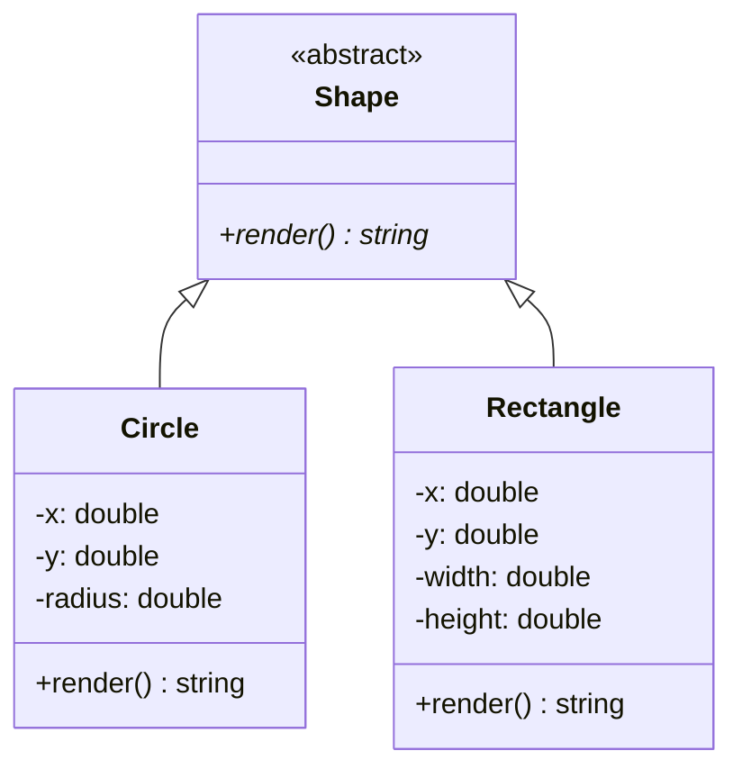

# L'héritage et le polymorphisme

> 🤖 Rédaction assistée par IA.

## Définition

L'**héritage** permet de définir une **classe dérivée** (ex : `Circle`) à partir d'une **classe de base** (ex : `Shape`) dont elle reprend les attributs et les méthodes. Il traduit une relation « **est un** » (un cercle est une forme).

Le **polymorphisme** permet de **manipuler des objets de types différents à travers un type commun** : lors de l'appel d'une méthode (ex : `shape.render()`), c'est l'**implémentation propre au type réel de l'objet** qui est exécutée.

Une **méthode abstraite** est déclarée dans la classe de base sans y être implémentée : chaque classe dérivée doit en fournir l'implémentation.

## Cas d'école

Considérons une fonction qui dessine des formes géométriques :

```ts
function render(shape: Shape): string {
    if (shape instanceof Circle) {
        // dessin d'un cercle
    } else if (shape instanceof Rectangle) {
        // dessin d'un rectangle
    } else {
        throw new TypeNotSupportedError(shape);
    }
}
```

Avec cette approche :

* L'**ajout d'une nouvelle forme** (ex : `Triangle`) impose de **modifier toutes les fonctions** qui testent le type des formes.
* L'oubli d'un cas ne sera détecté qu'**à l'exécution** (`TypeNotSupportedError`).

## Solution

Le principe consiste à déclarer une **méthode abstraite** `render` dans la classe de base `Shape` et à l'implémenter dans chaque classe dérivée :



Pour simplifier, `render` renvoie ici un fragment SVG :

=== "TypeScript"

    ```ts
    abstract class Shape {
        abstract render(): string;
    }

    class Circle extends Shape {
        constructor(private x: number, private y: number, private radius: number) {
            super();
        }

        render(): string {
            return `<circle cx="${this.x}" cy="${this.y}" r="${this.radius}" />`;
        }
    }

    class Rectangle extends Shape {
        constructor(private x: number, private y: number, private width: number, private height: number) {
            super();
        }

        render(): string {
            return `<rect x="${this.x}" y="${this.y}" width="${this.width}" height="${this.height}" />`;
        }
    }

    const shapes: Shape[] = [new Circle(5, 5, 2), new Rectangle(0, 0, 4, 3)];
    for (const shape of shapes) {
        console.log(shape.render()); // appelle Circle.render() ou Rectangle.render()
    }
    ```

=== "Java"

    ```java
    abstract class Shape {
        public abstract String render();
    }

    class Circle extends Shape {
        private double x;
        private double y;
        private double radius;

        public Circle(double x, double y, double radius) {
            this.x = x;
            this.y = y;
            this.radius = radius;
        }

        @Override
        public String render() {
            return String.format("<circle cx=\"%s\" cy=\"%s\" r=\"%s\" />", x, y, radius);
        }
    }

    class Rectangle extends Shape {
        private double x;
        private double y;
        private double width;
        private double height;

        public Rectangle(double x, double y, double width, double height) {
            this.x = x;
            this.y = y;
            this.width = width;
            this.height = height;
        }

        @Override
        public String render() {
            return String.format("<rect x=\"%s\" y=\"%s\" width=\"%s\" height=\"%s\" />", x, y, width, height);
        }
    }

    List<Shape> shapes = List.of(new Circle(5, 5, 2), new Rectangle(0, 0, 4, 3));
    for (Shape shape : shapes) {
        System.out.println(shape.render()); // appelle Circle.render() ou Rectangle.render()
    }
    ```

=== "Python"

    ```python
    from abc import ABC, abstractmethod


    class Shape(ABC):
        @abstractmethod
        def render(self) -> str: ...


    class Circle(Shape):
        def __init__(self, x: float, y: float, radius: float) -> None:
            self.x = x
            self.y = y
            self.radius = radius

        def render(self) -> str:
            return f'<circle cx="{self.x}" cy="{self.y}" r="{self.radius}" />'


    class Rectangle(Shape):
        def __init__(self, x: float, y: float, width: float, height: float) -> None:
            self.x = x
            self.y = y
            self.width = width
            self.height = height

        def render(self) -> str:
            return f'<rect x="{self.x}" y="{self.y}" width="{self.width}" height="{self.height}" />'


    shapes: list[Shape] = [Circle(5, 5, 2), Rectangle(0, 0, 4, 3)]
    for shape in shapes:
        print(shape.render())  # appelle Circle.render() ou Rectangle.render()
    ```

=== "C++"

    ```cpp
    class Shape {
    public:
        virtual ~Shape() = default;
        virtual std::string render() const = 0;
    };

    class Circle : public Shape {
    public:
        Circle(double x, double y, double radius) : x(x), y(y), radius(radius) {}

        std::string render() const override {
            std::ostringstream os;
            os << "<circle cx=\"" << x << "\" cy=\"" << y << "\" r=\"" << radius << "\" />";
            return os.str();
        }

    private:
        double x;
        double y;
        double radius;
    };

    class Rectangle : public Shape {
    public:
        Rectangle(double x, double y, double width, double height)
            : x(x), y(y), width(width), height(height) {}

        std::string render() const override {
            std::ostringstream os;
            os << "<rect x=\"" << x << "\" y=\"" << y << "\" width=\"" << width << "\" height=\"" << height << "\" />";
            return os.str();
        }

    private:
        double x;
        double y;
        double width;
        double height;
    };

    std::vector<std::unique_ptr<Shape>> shapes;
    shapes.push_back(std::make_unique<Circle>(5, 5, 2));
    shapes.push_back(std::make_unique<Rectangle>(0, 0, 4, 3));
    for (const auto& shape : shapes) {
        std::cout << shape->render() << std::endl; // appelle Circle::render() ou Rectangle::render()
    }
    ```

=== "PHP"

    ```php
    abstract class Shape
    {
        abstract public function render(): string;
    }

    class Circle extends Shape
    {
        public function __construct(
            private float $x,
            private float $y,
            private float $radius,
        ) {
        }

        public function render(): string
        {
            return sprintf('<circle cx="%s" cy="%s" r="%s" />', $this->x, $this->y, $this->radius);
        }
    }

    class Rectangle extends Shape
    {
        public function __construct(
            private float $x,
            private float $y,
            private float $width,
            private float $height,
        ) {
        }

        public function render(): string
        {
            return sprintf('<rect x="%s" y="%s" width="%s" height="%s" />', $this->x, $this->y, $this->width, $this->height);
        }
    }

    $shapes = [new Circle(5, 5, 2), new Rectangle(0, 0, 4, 3)];
    foreach ($shapes as $shape) {
        echo $shape->render(), "\n"; // appelle Circle::render() ou Rectangle::render()
    }
    ```

L'ajout d'une forme `Triangle` se limite alors à **ajouter une classe** implémentant `render` : le code qui parcourt les formes reste inchangé. De plus, l'oubli de l'implémentation de `render` sera signalé **dès la compilation** avec un typage statique.

## Variantes

### Liaison dynamique en C++

En C++, le polymorphisme n'est pas le comportement par défaut : une méthode doit être déclarée **`virtual`** pour que l'implémentation du type réel soit appelée. Sans `virtual`, `shape.render()` appellera `Shape::render()` même si `shape` référence un `Circle`.

Le mot clé `override` permet de vérifier à la compilation qu'une méthode redéfinit bien une méthode virtuelle.

### Polymorphisme sans héritage

Les langages à typage dynamique permettent d'appeler `shape.render()` sur tout objet disposant d'une méthode `render`, sans que les classes héritent d'une classe commune (*duck typing*, voir [Les spécificités des langages](../../architecture/patrons-conception/specificites-langages/index.md#typage-statique-ou-typage-dynamique)).

Avec un typage statique, un type commun reste nécessaire mais il pourra prendre la forme d'une [interface](interface.md) plutôt que d'une classe de base.

## Mises en garde

* L'héritage doit traduire une relation « **est un** » : une classe dérivée doit pouvoir être utilisée partout où la classe de base est attendue ([principe de substitution de Liskov](https://fr.wikipedia.org/wiki/Principe_de_substitution_de_Liskov)).
* L'héritage n'est pas le seul moyen de **réutiliser du code** : la **composition** (un objet en utilise un autre) est souvent plus souple (voir par exemple les patrons [Strategy](../../architecture/patrons-conception/comportement/Strategy.md) et [Decorator](../../architecture/patrons-conception/structure/Decorator.md)).
* Les **hiérarchies profondes** (nombreux niveaux d'héritage) deviennent difficiles à comprendre et à faire évoluer.

## Liens utiles

* [mborne.github.io/cours-patron-conception - Comprendre la POO](https://mborne.github.io/cours-patron-conception/poo.html)
* [fr.wikipedia.org - Héritage (informatique)](https://fr.wikipedia.org/wiki/H%C3%A9ritage_(informatique))
* [fr.wikipedia.org - Polymorphisme (informatique)](https://fr.wikipedia.org/wiki/Polymorphisme_(informatique))
