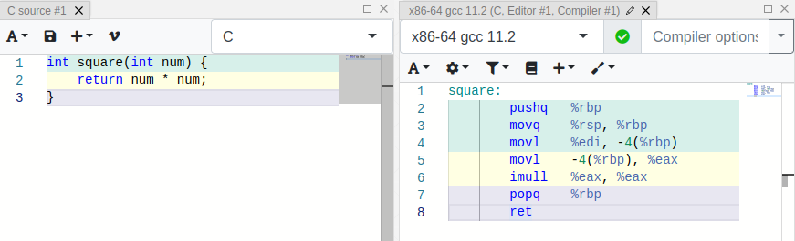
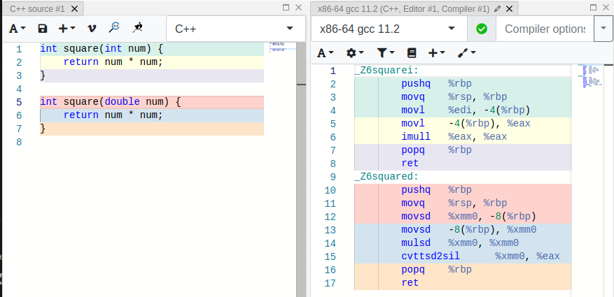

# La décoration des noms (name mangling)

!!! warning "En construction"

    Notes personnelles à relire et compléter pour servir de support pour les cours.

La **décoration des noms** (*name mangling*) consiste, pour le compilateur, à encoder la **signature d'une fonction** (nom et types des paramètres) dans le nom du symbole généré. C'est ce mécanisme qui permet la [surcharge](../base/fonction.md#signature-de-fonction) (plusieurs **fonctions de même nom** avec des **paramètres de types différents**).

## Cas du C

En C, **ce mécanisme de signature de fonction n'est pas présent**. Le type des paramètres n'influence pas le nom de la fonction assembleur générée pour un code en C :

Il est donc impossible d'avoir deux fonctions du même nom telles `square(int)` et `square(double)`.

## Cas du C++

En C++, on note que la cohabitation entre ces deux fonctions est rendue possible par des **signatures de fonction différentes** :

## À compléter

* `extern "C"` pour désactiver la décoration des noms en C++ et rendre une fonction appelable depuis du C (voir [L'interfaçage entre les langages](interfacage.md))
* Le lien avec l'ABI (*Application Binary Interface*)

## Ressources

* [en.wikipedia.org - Name mangling](https://en.wikipedia.org/wiki/Name_mangling)
